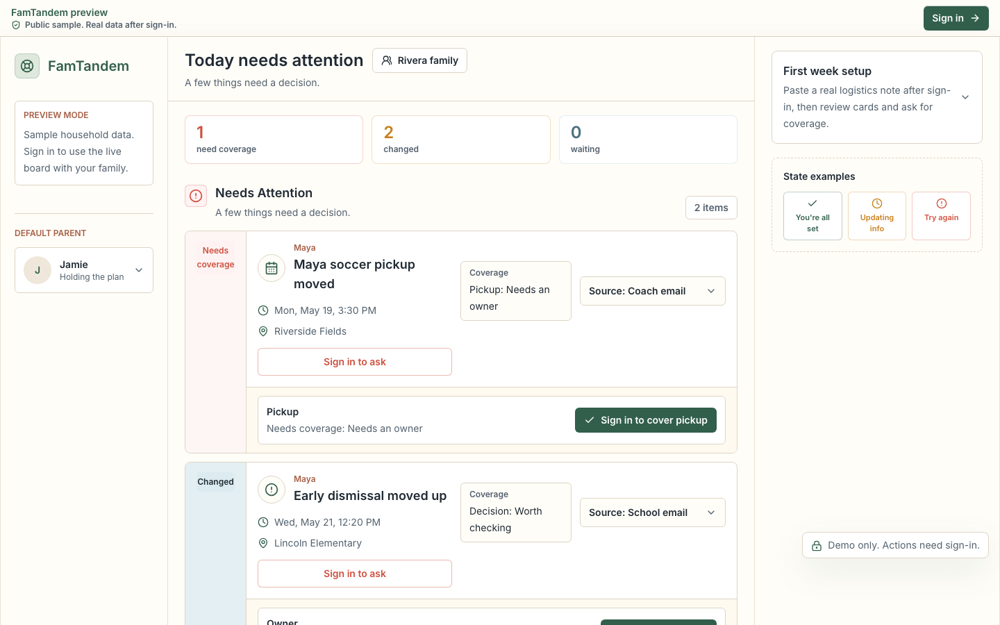
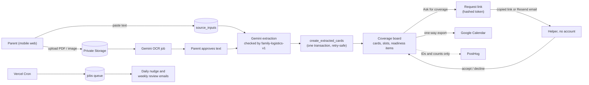

# FamTandem

Families don't have a calendar problem. They have a logistics and coverage problem.

FamTandem is a mobile-first web app that reads school emails, team schedules and flyer screenshots, then builds a shared board where each pickup, drop-off and permission slip has a named owner. It's live at **[app.famtandem.com](https://app.famtandem.com)**.



## The problem

In a busy household with two working parents and a couple of kids, one parent usually ends up holding the plan. They read every school email, catch the practice that moved, and remember who said they'd do pickup. A shared calendar shows what is happening and when, but it doesn't show who owns it, what changed, or what nobody has picked up yet. FamTandem is for that default parent.

## What I built

All of this is in the code and running in production.

- Paste a school email, a coach's text or a portal notice, and Gemini (`gemini-3.5-flash` by default) turns it into structured cards. A Zod schema (`family-logistics-v1`) checks the model's output before anything is saved.
- Upload a screenshot or PDF of up to 10 MB and it goes to a private Supabase Storage bucket. Gemini OCR pulls out the text, and a parent approves that text before any card is created.
- The coverage board opens on Needs Attention, with This Week below. Each card has coverage slots (drop-off, pickup, stay, bring), readiness items like forms and payments, and a link back to its source.
- A parent can ask someone to take a slot. That person gets a link, copied or emailed through Resend, and accepts or declines without signing up. Links expire, and the tokens behind them are stored as HMAC hashes.
- A cron-driven job queue sends a daily email of unresolved items and a weekly coverage review. Both are off by default for each household.
- The source inbox lists everything a parent has submitted, with its extraction status and the cards it produced. Parents can fix anything the model got wrong.
- Household setup covers kids, helpers, magic-link invites for other adults, and recurring manual events. Timed cards export one way to Google Calendar, with refresh tokens encrypted using AES-256-GCM.
- For validation there's an admin metrics page with CSV export, an ops page for job and extraction health, retry for failed runs, and an extraction eval suite of 24 synthetic fixtures.

I haven't built a forwarding email address yet (for the beta, parents paste the email text), or SMS through Twilio, Gmail sender watching, two-way calendar sync, or a native iOS app. Each one waits until the beta shows it's the bottleneck. Staying on the web also means a grandparent can answer a pickup request without installing anything.

## How it fits together



## Product decisions

### Every covered slot names an owner

Competitor research for this project found that Cozi, Skylight and FamilyWall mostly give a family shared visibility, so the gap was responsibility. In FamTandem a slot can't be accepted or marked covered without a named person, and a database check constraint enforces it. "Already covered" still asks who, and it takes free-form owners like Grandma or the school bus. If a source leaves the owner unclear, extraction flags the card for review and leaves the owner blank.

### The model drafts and the parent confirms

The first product brief said parents should find the app transparent and careful, so every AI-made card links back to its source. A card gets a Needs Review flag when confidence is below 0.75, when a date is missing or ambiguous, when the source changes an existing plan, or when the item involves forms, payments or medication. Uploads add one more step: OCR text waits for a parent's approval before extraction runs, so no card comes from text nobody has read.

### Helpers see only what they need

A grandparent answering a pickup request needs the what, when, where and which child, and nothing more. Postgres row-level security scopes household data by membership. Helpers can't read raw source text or uploaded files, and the response page shows the minimum context. Analytics events carry internal IDs and size buckets, never pasted text or children's names.

## Status

FamTandem runs on Vercel at app.famtandem.com and was piloted with a first beta household in mid-2026. Before a deploy that touches the first-session flow, a guarded script runs the hosted app end to end. It logs in by magic link, sets up a household, pastes three logistics notes, checks the cards that come back, and accepts a coverage request from a signed-out mobile browser. The docs follow the build from the first positioning brainstorm (May 18, 2026) to the hosted login fixes (June 7, 2026). The plan's next step is a cohort of 10 to 20 families, measured against one question: *"Did this reduce the number of times you had to ask, remind, clarify, or hold the plan in your head this week?"*

## About this repo

Built by Krish Puvvada, AI product leader. More at [krishpuvvada.com](https://krishpuvvada.com).

I built FamTandem on my own time, with Claude Code as my pair. This repo is a single-commit snapshot of a private working repo, and personal names and email addresses have been replaced with test values. Most feature slices have a written plan in `docs/plans/`, and when something broke, the root cause and fix are written up in `docs/solutions/`.

## Run it

You'll need Node 22 or newer. The unit tests don't need a database or API keys:

```bash
npm ci
npm test                 # 278 unit tests in 61 files
npm run test:extraction  # extraction schema + 24 fixture cases
```

To run the app itself, you need a local Supabase stack (Docker):

```bash
cp .env.example .env.local
npx supabase start       # copy the local API URL, anon key and service role key into .env.local
npx supabase db reset    # applies the 23 migrations
npm run dev
```

Gemini, Resend and Google Calendar are off by default and fall back to local stubs. You can turn each one on in `.env.local`. Browser tests run on mobile and desktop Chrome with `npm run test:e2e:local`. Full setup notes are in [`docs/setup/local-development.md`](docs/setup/local-development.md).

## Stack

- Next.js 15 (App Router), React 19, TypeScript, Tailwind
- Supabase: magic-link auth, Postgres with row-level security, private Storage
- Gemini for extraction and OCR, with output validated by Zod
- Resend for email, the Google Calendar API for export, PostHog for analytics
- Vercel for hosting and cron
- Vitest with Testing Library, and Playwright with axe-core

## Docs

- [`docs/brainstorms/`](docs/brainstorms/): positioning and product shape. Start with the [first product shape](docs/brainstorms/2026-05-19-famtandem-first-product-shape-brainstorm.md).
- [`docs/plans/`](docs/plans/): one plan per feature slice.
- [`docs/solutions/`](docs/solutions/): bug and integration write-ups, each with its root cause and fix.
- [`docs/architecture.md`](docs/architecture.md): data model, job runner and privacy defaults.
- [`docs/qa/`](docs/qa/): the test plan and the hosted regression suite.
- `AGENTS.md` and `CLAUDE.md`: the context files the coding agents read.
