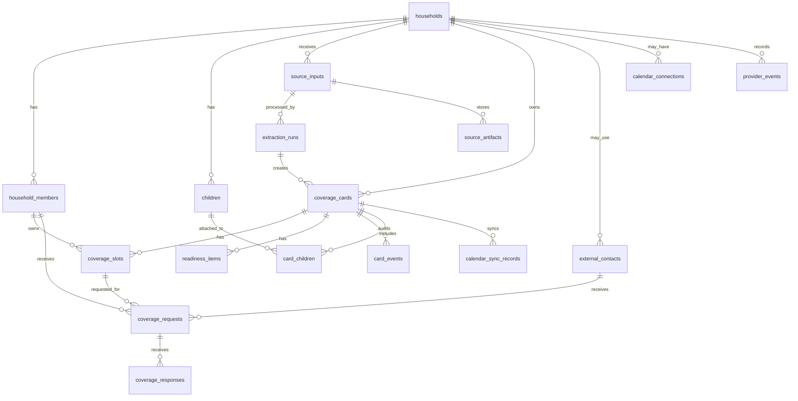

# feat: Build First Thin Real App

## Overview

Build the first thin real FamTandem app that validates the core loop:

```text
input -> source-backed coverage card -> coverage ask -> accepted response
```

The app should be a mobile-first web app centered on a live shared coverage board, not a calendar replacement or generic family organizer. It should let 10-20 high-complexity families submit real logistics inputs, generate source-backed coverage cards, ask another adult/helper for coverage through SMS/email links, and measure whether this reduces the default parent's logistics load.

This plan carries forward the first product shape from the brainstorm: live shared coverage board, family logistics inbox, event-anchored cards, source/confidence trust model, lightweight helper participation, user-side editing, admin correction, and optional Google Calendar sync (see brainstorm: `docs/brainstorms/2026-05-19-famtandem-first-product-shape-brainstorm.md`).

## Problem Statement

The validation question is not "can we build a family calendar?" It is:

> Can FamTandem reduce the number of times the default parent has to ask, remind, clarify, or hold the plan in their head?

Existing calendars show what/when/where. They do not reliably answer who owns pickup, what changed, whether someone accepted the request, whether a form/payment/supply item is tied to an event, or whether a decision is still unresolved. The first app must prove that messy family inputs can become a covered plan with less manual coordination.

## Proposed Solution

Create a production-backed but deliberately thin app with these surfaces:

- Mobile-first household app with `Needs Attention` first and `This Week` below.
- Family logistics intake through paste text, upload file/image/PDF, and inbound forwarding email.
- Gemini extraction into structured source-backed cards with confidence and review flags.
- Coverage cards for event, deadline, decision, and unmatched change items.
- Coverage slots for drop-off, pickup, stay/attend, and bring/prep only when relevant.
- SMS/email coverage asks with no-account response links.
- User-side card editing and "mark already covered" with a named responsible person or free-form external owner.
- Small admin correction surface for early extraction quality control.
- Optional Google Calendar connect/read/import in milestone one; defer write-back to milestone 1.5 unless it is trivial after the board loop ships.
- PostHog metrics tied to validation, not vanity usage.

## Confirmed Planning Decisions

- **Backend:** Use Supabase for v1 because it is the fastest credible path to auth, Postgres, RLS, and private source storage. Document an exit path in `docs/architecture.md` so the app can move if RLS, storage privacy, or operational needs outgrow Supabase.
- **V0 infrastructure cost posture:** Start with Supabase Free plus Vercel Cron for internal/friends testing if needed. Supabase Pro is recommended before a broader external cohort, but it is not required to begin building or to let a small trusted group try the app.
- **Google Calendar:** Keep optional calendar connect/read/import in the first build, but do not let it delay the board loop. Calendar write-back is a milestone 1.5 item by default.
- **Admin correction:** Keep the admin surface intentionally narrow: view source, view extraction, view generated cards, edit generated card fields, rerun extraction, and audit corrections. Exclude queues, assignment workflows, bulk operations, internal CRM behavior, and other operations tooling from v1.
- **Sensitive data:** Use stricter cohort consent. Families should not forward detailed medical, financial, legal, custody, or highly sensitive personal records during early testing. Basic appointment logistics are acceptable.
- **Validation milestone:** Treat Phase 3 as the first real MVP validation milestone: a real input becomes a card, an uncovered slot is found, a request is sent, a recipient accepts through a no-account link, and the board updates.
- **Scope posture:** The team can build the broader product over time. The v1 boundary is about sequencing and learning clarity, not a lack of confidence in implementation capacity.

## Engineering Review Decisions

### Batch 1: Architecture and Privacy

- **Token links:** Store only hashed request tokens. Token links must be scoped to one request, short-lived, rate-limited, auditable, and state-limited so an already-accepted/declined request cannot be reused to mutate coverage again. Expired links should show a safe renewal path without exposing household board data.
- **External contacts:** Model lightweight external contacts separately from household members and snapshot request contact details at send time. This preserves auditability for Grandma/carpool/aftercare-style owners without requiring full accounts.
- **Source access:** Keep source artifacts private. Parent/full household users and internal admins may access full source through authorized app routes and signed URLs. Helper token pages should show compact source summary and specific evidence excerpts by default, not full forwarded emails, PDFs, or screenshots.
- **Admin roles:** Separate household administration from internal founder/admin correction access. `household_admin` can manage a household; `internal_admin` can inspect/correct extraction across households only through audited admin routes.
- **Webhook idempotency:** Persist provider event ids/idempotency keys for inbound email, SMS status callbacks, calendar import, and other provider webhooks so retries do not create duplicate sources, responses, cards, or analytics events.

### Batch 2: Data Model and State

- **Card type vs attention state:** Keep card type stable and separate from attention flags. Use `card_type` for the object shape (`event`, `deadline`, `decision`; allow standalone `change` only when no parent event can be matched). Use `attention_flags` for board surfacing (`needs_coverage`, `pending`, `changed`, `needs_review`, `due_soon`, `overdue`). Derive coverage state from slots instead of manually editing a broad card status whenever possible.
- **Coverage slot state machine:** Define explicit slot transitions: `needs_coverage -> requested -> accepted | declined | cancelled`, with `covered_external` for offline/external owners such as Grandma, aftercare, school bus, or carpool. Re-requesting coverage creates a new request record rather than mutating old response history.
- **Change detection:** When a new source appears to describe an existing event, create a match/change record instead of blindly overwriting the card. Critical fields such as time, location, child, and coverage slot details require user/admin confirmation before overwriting once coverage exists.
- **External owner reuse:** "Someone else" should store free-form owner text immediately and optionally link to or create an `external_contact` so repeated owners do not become disconnected text blobs.
- **Readiness ownership:** Readiness items stay event-anchored and do not become generic chores, but they may have a lightweight owner and completion state for forms, payments, supplies, or bring/prep items.

### Batch 3: Testing and Evals

- **Default test stack:** Use Vitest for unit/integration tests, Supabase local testing where practical for database/RLS behavior, Playwright for end-to-end flows, and lightweight accessibility checks in Playwright for critical mobile surfaces.
- **Extraction evals:** Add a fixture-based Gemini extraction eval suite, not only schema tests. Start with 10-20 anonymized logistics inputs and expected cards, slots, readiness items, change flags, confidence bands, and review reasons.
- **Security/RLS tests:** Treat household isolation, helper token scope, internal admin access, expired/used/rate-limited tokens, and source artifact access as first-class test paths.
- **Provider webhook tests:** Use provider payload fixtures for Resend inbound email, Twilio callbacks, Google Calendar import/sync callbacks when enabled, malformed signatures, duplicate webhook delivery, and attachment fetch failure.
- **Job runner tests:** Test the Vercel Cron job runner's cron secret, due-job claiming, batch size, locked-job skip, bounded retries, stale lock recovery, and admin-visible failure state.
- **QA artifact:** During CE work, create `docs/qa/famtandem-thin-app-test-plan.md` with affected routes, critical flows, edge cases, provider webhook test commands, mobile viewport checks, and extraction eval commands.

### Batch 4: Performance and Operations

- **V0 source limits:** For v0/friends testing, limit uploads to 10 MB per file and 5 files per source input. Oversized uploads should fail into a friendly user/admin state rather than silently disappearing. Store normalized text separately from raw artifacts.
- **Upload path:** Do not send large files through Vercel Function request bodies. Use direct-to-Supabase Storage or signed upload flow for files, then have Next.js routes handle metadata, source input creation, and job enqueueing.
- **Retention checkpoint:** Before the broader external cohort, decide source artifact retention defaults and review Supabase database/storage usage. Keep full raw artifacts only as long as needed for trust, correction, and early learning.
- **Vercel Cron upgrade triggers:** Keep Vercel Cron for v0/friends, but move to Supabase Cron/Edge Functions, Cloud Tasks/Cloud Run, or a dedicated queue if any of these persist: backlog over 50 pending jobs for 30 minutes, extraction p95 over 120 seconds, timeout rate over 5%, stale locks recurring daily, or normal source processing delay over 15 minutes.
- **Admin ops visibility:** The admin surface should include lightweight system health: pending/running/failed jobs, oldest pending job age, extraction success/failure/retry counts, storage usage estimate, provider webhook failures, failed SMS/email sends, and recent admin corrections.
- **Pre-cohort quota checklist:** Before inviting a broader external cohort, review Supabase storage/database usage, Vercel function duration and cron logs, Resend daily/monthly quota, Twilio send failures/costs, Gemini extraction latency/cost samples, and whether to upgrade from free tiers.
- **Pre-cohort SMS checklist:** Before broader external testing, review Twilio sender type, A2P 10DLC/compliance requirements for US long-code messaging, opt-out language, expected segment count, failed-message behavior, and SMS cost guardrail.
- **Analytics privacy:** PostHog properties should use internal ids and coarse buckets. Do not send raw child names, source text, phone numbers, emails, addresses, or extracted source excerpts to analytics.

## Technical Approach

### Architecture

Use a boring, fast stack optimized for validation:

- **Web app:** Next.js App Router, TypeScript, React, Tailwind, shadcn/ui where useful.
- **Auth and database:** Supabase Auth + Postgres with Row Level Security for household-scoped data.
- **File storage:** Supabase Storage for uploaded source files and normalized source text artifacts.
- **Inbound email:** Resend receiving webhook for family forwarding addresses.
- **SMS:** Twilio Programmable Messaging for coverage asks and status callbacks.
- **Email:** Resend outbound email for context-rich requests and weekly reviews.
- **Extraction:** Gemini structured output with schema validation and a persisted extraction audit trail.
- **Analytics:** PostHog client and server-side events for validation metrics.
- **Background work:** Start with a `jobs` table and Vercel Cron calling a protected Next.js route for extraction, nudges, and email summaries. Keep the runner deliberately simple but safe: cron secret, batch limits, job claiming/locking, retry count, stale lock recovery, and visible admin job status. Move to Supabase Cron/Edge Functions, Cloud Tasks/Cloud Run, or a dedicated queue if jobs regularly time out, pile up, or need stronger observability.
- **Deployment:** Vercel for the app and route handlers; Supabase managed Postgres/Storage; provider webhooks configured against production/staging URLs.

Rationale:

- Next.js route handlers fit webhooks from Resend, Twilio, and Google while keeping the first product in one app.
- Supabase gives a quick real database, storage, auth, and RLS posture without building account infrastructure from scratch.
- Supabase should be treated as the v1 acceleration choice, with clear abstraction boundaries around auth, storage, and data access documented before cohort launch.
- Vercel Cron is acceptable for v0 and small trusted testing because it schedules the worker route without requiring Supabase Pro. The app still owns basic job semantics until a queue/worker platform is introduced.
- Free-tier infrastructure is acceptable for v0/friends only if limits and upgrade triggers are visible in admin/ops surfaces.
- Gemini structured output fits the source-to-card extraction workflow, but every model response must be validated and editable.
- Twilio and Resend match the brainstorm assumption: SMS asks for action, email gives context.

### Core Data Model



Suggested tables:

- `households`: name, slug, timezone, cohort metadata, consent version.
- `household_members`: household, role (`parent`, `helper`, `household_admin`), display name, email, phone, auth user id nullable, notification prefs, active flag.
- `children`: household, display name, optional birth year/grade, active flag. Children attach to cards but cannot own coverage in v1 (see brainstorm).
- `external_contacts`: household, display name, email nullable, phone nullable, relationship label nullable, created_by, active flag. Used for one-off helpers and external owners who do not need household accounts.
- `internal_admins`: auth user id, role, active flag. Kept separate from household membership and used only for audited internal correction/support routes.
- `source_inputs`: household, submitted_by, source type (`forwarded_email`, `upload`, `paste`, `calendar_invite`, `manual_admin`), raw subject/filename, normalized text, status, received_at, provider event id/idempotency key nullable.
- `source_artifacts`: source input, storage path, mime type, text extraction status, checksum.
- `extraction_runs`: source input, model/version, prompt/schema version, raw output path, confidence summary, status, error, admin notes.
- `coverage_cards`: household, source input, card type (`event`, `deadline`, `decision`, `change_standalone` only when no parent event can be matched), title, starts_at, ends_at, all_day, location, attention flags (`needs_coverage`, `pending`, `changed`, `needs_review`, `due_soon`, `overdue`), computed coverage state, confidence, source_summary, full_source_ref, review_reason, manually_edited flag.
- `coverage_slots`: card, kind (`dropoff`, `pickup`, `stay_attend`, `bring_prep`, `general_owner`), state (`needs_coverage`, `requested`, `accepted`, `declined`, `cancelled`, `covered_external`), owner member id nullable, external contact id nullable, external_owner_text nullable.
- `readiness_items`: card, label, due_at nullable, status (`open`, `done`, `not_needed`), owner member id nullable, external contact id nullable, external_owner_text nullable, completed_at nullable, source_quote_ref nullable.
- `card_children`: card, child.
- `card_changes`: source input, matched card nullable, change summary, changed fields, previous values, new values, confirmation status, confirmed_by nullable, confirmed_at nullable. Used for detected updates to existing events/cards.
- `coverage_requests`: slot, requested_by, requested_member nullable, requested_external_contact nullable, immutable contact snapshot, channel (`sms`, `email`), token hash, expires_at, status, attempt count, last token access at, provider message id nullable.
- `coverage_responses`: request, responder identity, response (`accept_dropoff`, `accept_pickup`, `accept_both`, `decline`, `comment`), raw payload, responded_at.
- `card_events`: audit log for card creation, edits, requests, responses, decline, admin correction, calendar sync.
- `calendar_connections`: household/member, provider, OAuth tokens encrypted, scopes, sync direction, status.
- `calendar_sync_records`: card, provider event id, sync status, last synced at, last error.
- `provider_events`: provider, provider event id/idempotency key, event type, household nullable, received at, processed at, status, raw metadata path nullable. Unique by provider/event id where available.
- `jobs`: kind, payload, status, attempts, run_after, locked_at, last_error.

### Extraction Contract

Define a versioned Zod schema for extraction output:

```ts
type ExtractedFamilyLogistics = {
  sourceSummary: string;
  cards: Array<{
    type: "event" | "deadline" | "decision" | "change_standalone";
    title: string;
    childNames?: string[];
    startsAt?: string;
    endsAt?: string;
    location?: string;
    coverageRelevance: {
      needsTransportation?: boolean;
      suggestedSlots: Array<"dropoff" | "pickup" | "stay_attend" | "bring_prep" | "general_owner">;
      reason: string;
    };
    readinessItems?: Array<{ label: string; dueAt?: string }>;
    possibleMatch?: { existingCardHint?: string; reason: string };
    changedFields?: Array<{ field: string; previousValue?: string; newValue: string }>;
    decisionNeeded?: string;
    confidence: number;
    reviewReasons: string[];
    sourceEvidence: Array<{ label: string; excerptRef: string }>;
  }>;
};
```

Rules:

- Store raw model output separately from accepted app state.
- Validate model output before creating cards.
- Mark cards `needs_review` when confidence is low, key time/location fields are missing, multiple possible dates exist, the card contains payment/medical/action-heavy content, or the schema validator had to coerce fields.
- Treat changes as update signals attached to existing cards when possible. Create standalone change cards only when the source clearly contains a logistics change but no parent event can be matched.
- Do not overwrite critical covered-event fields such as time, location, child, or coverage slot details without user/admin confirmation once coverage exists.
- Preserve source linkage on every AI-created card (see brainstorm).
- Use admin correction to improve extraction prompts and schemas, not to hide model uncertainty.

### User Flows

1. **First login and consent**
   - User signs in.
   - Creates household and accepts plain cohort consent.
   - Adds self, optional spouse/helper, and children.
   - Sees sample board until first real card exists.

2. **Paste input**
   - User opens "Add logistics".
   - Pastes copied text.
   - System creates `source_input`, queues extraction, then shows processing state.
   - Extracted cards appear in `Needs Attention` if unresolved or `This Week` if covered/low-risk.

3. **Upload input**
   - User uploads PDF/image/screenshot.
   - System stores file, extracts text where possible, queues Gemini extraction.
   - If OCR/text extraction fails, mark source as needing admin review.

4. **Forwarded email input**
   - Family gets a forwarding address.
   - Resend inbound webhook receives email metadata, content, and attachment references.
   - System records provider event id/idempotency key, maps recipient alias to household, stores source, downloads attachments, queues extraction.
   - Webhook retries with the same provider event id do not create duplicate source inputs or duplicate extraction jobs.

5. **Review and edit card**
   - Parent opens card.
   - Sees compact source, confidence/review state, slots, readiness, and full source behind expansion.
   - Parent can edit title, time, location, child, slots, owner, readiness items, source interpretation, and status.

6. **Ask for coverage**
   - Parent taps "Ask for coverage".
   - Chooses slot(s), target person/contact, and channel.
   - System sends SMS for action and optional email for context.
   - Request remains `pending` until accepted or declined.

7. **Lightweight response link**
   - Recipient opens tokenized link without account creation.
   - System verifies hashed token, expiry, request state, rate limit, and request scope before rendering details.
   - Sees only what they need: what, when, where, child, requested responsibility, compact source summary, selected evidence excerpts, accept/decline controls.
   - Full forwarded emails, PDFs, screenshots, and household board access are not exposed on helper token pages by default.
   - Accepting assigns the selected slot(s); declining returns slot to `needs_coverage` and records who declined.
   - Reopening an already-accepted/declined token shows current request state but does not mutate coverage again.

8. **Mark already covered**
   - Parent taps "Mark already covered".
   - Must choose a household member/helper or "Someone else".
   - "Someone else" requires free-form owner text such as Grandma, aftercare, school bus, or carpool parent (see brainstorm).
   - Free-form external owner text is stored immediately and may be linked to or create an `external_contact` for reuse.

9. **Admin correction**
   - Admin opens source input.
   - Views raw source, extracted fields, generated cards, confidence, source links, and errors.
   - Can edit/save corrected card data or rerun extraction.
   - Internal admin access uses a separate `internal_admin` role and writes an audit event for every source view, correction, and rerun.

10. **Daily and weekly rhythm**
   - Daily unresolved nudge highlights urgent uncovered/changed/due-soon items.
   - Weekly review email summarizes uncovered slots, changes, pending requests, and due-soon readiness items.

11. **Detected change confirmation**
   - New source input may match an existing card through child, title, date/time, location, source sender, or provider metadata.
   - If the source changes non-critical context, the card can record an audit event and attention flag.
   - If the source changes critical fields after coverage exists, create a `card_changes` record and show `Changed` until a parent/admin confirms the update.

### Flow Permutations Matrix

| Flow | First-time default parent | Returning default parent | Helper/caregiver | Admin | Failure path |
| --- | --- | --- | --- | --- | --- |
| Household setup | Creates household, consent, members | Edits members | No full account required | Can inspect household | Missing consent blocks cohort use |
| Intake | Sees sample board and checklist | Adds more sources | Not needed in v1 | Can create manual source | Extraction fails into admin review |
| Board | Needs Attention first | Needs Attention plus This Week | Token link only by default | Full correction context | Empty state remains sample until real card |
| Coverage ask | Sends first request | Sends/renews request | Accepts/declines link | Can resend/debug | Expired token prompts request renewal |
| Mark covered | Must name owner | Same | Not default path | Can correct owner | No owner selection blocks save |
| Calendar | Optional connect after value loop | Optional sync | No calendar access | Debug sync records | OAuth failure does not block board |

## Implementation Phases

### Phase 0: Product/Infra Foundation

Deliverables:

- [x] Create Next.js/TypeScript app scaffold.
- [x] Configure Supabase project, auth, RLS baseline, migrations, and storage buckets.
- [x] Add environment management for local/staging/production.
- [x] Add PostHog client/server setup and event helper.
- [x] Add `jobs` table baseline and protected Vercel Cron route with cron secret, batch size limit, job locking, retries, stale lock recovery, and admin-visible job status.
- [x] Add basic app shell, mobile-first layout, auth screen shell, and protected household setup route.
- [x] Add plain cohort consent copy and storage.

Phase 0 verification:

- [x] Next.js build passes with required local environment variables.
- [x] TypeScript strict check passes.
- [x] ESLint baseline passes.
- [x] Vitest unit tests pass for env validation, job runner behavior, and board shell ordering.
- [x] Playwright mobile/desktop smoke tests pass for the app shell and accessibility scan.
- [x] Local setup, architecture, and QA docs are present.
- [x] Household bootstrap is transactional through a server-side RPC.
- [x] Direct household member self-insert is blocked by RLS.
- [x] Job RPC execution is restricted to Supabase `service_role`.
- [x] `/login` has a Supabase magic-link action and `/app` requires a signed-in user.

Success criteria:

- A signed-in user can create a household and see an authenticated empty/sample board.
- Household-scoped data is protected by RLS.
- Server events can be captured to PostHog.
- A protected Vercel Cron route can safely process a small batch of pending jobs and cannot be triggered without the cron secret.

### Phase 1: Data Model and Manual Board Loop

Deliverables:

- Implement core tables: households, members, children, source inputs, cards, slots, readiness items, requests/responses, audit events.
- Build household member and child profile setup.
- Build manual card creation/editing to validate UI and data model before AI extraction.
- Build board with `Needs Attention` and `This Week` sections.
- Build card attention and coverage logic for `Covered`, `Needs Coverage`, `Pending`, `Changed`, `Needs Review`, `Due Soon`, and `Overdue`.
- Build shared card attention and coverage calculation from card fields, readiness items, and coverage slot states.
- Build coverage slot state transitions for `needs_coverage`, `requested`, `accepted`, `declined`, `cancelled`, and `covered_external`.
- Build "I'll cover it" and "Mark already covered" with required owner selection/free-form external owner.

Success criteria:

- Founder can create real household data and manually create/edit cards.
- Uncovered cards surface at the top even when the event belongs later in the week.
- Marking covered without an owner is impossible.
- Local Supabase reset and RLS smoke validation pass for household isolation, helper self-coverage, helper setup denial, and cross-household owner/child/contact tampering.

### Phase 2: Input Pipeline and Extraction

Deliverables:

- [x] Paste text intake.
- [x] Create `source_inputs` rows from pasted logistics text.
- [x] Preserve compact source summary and full pasted source text references on source-backed cards.
- [x] Connect pasted source input to the existing board/card flow without provider credentials.
- [x] Upload source/artifact metadata foundation for PDF/image/screenshot/text files without OCR, Gemini, or binary upload UX.
- [x] Upload intake for one PDF/image/screenshot/text file with direct storage upload and source artifact creation.
- [x] Enforce v0 limit of 10 MB per file for the current single-file upload intake, with friendly client-side validation before metadata creation.
- [x] Use direct-to-Supabase Storage for files; Next.js routes receive file metadata/storage references, not large multipart file bodies.
- [x] Harden upload storage insert policy so objects must match an existing `source_artifacts.storage_path`.
- Resend inbound email webhook, household alias mapping, attachment handling, and source input creation.
- Job table and Vercel Cron worker route for extraction.
- Gemini structured extraction prompt/schema/versioning.
- Source/confidence display and full source expansion.
- Narrow admin correction view for source, extraction, generated card fields, confidence, rerun, and audit history. Do not add queues, assignment workflows, bulk operations, or internal CRM behavior.
- Lightweight admin ops view for pending/running/failed jobs, oldest pending job age, extraction success/failure/retry counts, storage usage estimate, provider webhook failures, failed sends, and recent admin corrections.

Paste-only slice status:

- [x] `/app` has an `Add logistics` form for pasted school/team/appointment text.
- [x] Paste intake creates `source_inputs.source_type = paste` with `normalized_text`, submitted member, source title, pending-to-processed status, and same-household source/card validation.
- [x] Paste intake creates one linked coverage card, one initial coverage slot, optional child link, and optional readiness item through the existing board flow.
- [x] Paste intake writes source/card/slot/optional child/optional readiness/card event through one authenticated Postgres RPC transaction.
- [x] Source-backed cards show compact source summary and full pasted source text in card source details.
- [x] Source-input/card analytics use internal ids and coarse source-size buckets only.
- [x] Hosted Supabase, Resend, Gemini, Twilio, and Google credentials are not required for this slice.
- [x] Upload/PDF/image intake, forwarded email, Gemini extraction, Twilio, Google Calendar, and broad admin correction remain deferred.

Extraction schema/eval slice status:

- [x] Versioned `family-logistics-v1` Zod extraction schema exists without Gemini calls.
- [x] Local fixture evaluator compares extracted cards, suggested slots, readiness items, change/review expectations, and schema validity.
- [x] Initial synthetic/anonymized fixtures cover a changed pickup source and an action-heavy form/payment readiness source.
- [x] Needs Review derivation flags low confidence, missing date/time, missing transportation location, change candidates, and action-heavy logistics items.
- [x] No `extraction_runs`, upload/storage flow, provider credentials, jobs, admin correction surface, analytics events, or database/RLS changes were added for this slice.
- [x] Expanded local fixture coverage to 15 synthetic/anonymized examples covering events, deadlines, decisions, changes, no-action sources, known coverage hints, ambiguous dates, multi-card schedules, readiness items, confidence bands, and review reasons.
- [x] Added optional live Gemini eval runner for the synthetic fixture suite; it requires `GEMINI_API_KEY` and writes no app/database/provider state.
- [x] Added read-only pasted source detail for parent/household-admin review, including source metadata, full normalized pasted text, linked cards, and helper denial.

Upload metadata/storage foundation status:

- [x] Added `source_artifacts` metadata for private `source-artifacts` bucket objects.
- [x] Enforced 10 MB file size and PDF/JPEG/PNG/WebP/plain-text MIME limits at the database layer.
- [x] Enforced same-household source/artifact references and scoped storage paths shaped as `household_id/source_input_id/file`.
- [x] Added `create_upload_source_metadata` to create an `upload` source plus first artifact metadata row and return the direct-upload storage path.
- [x] Extended source detail to show upload source type, artifact metadata, storage path, size, MIME type, checksum, and extraction status.
- [x] Tightened raw `source-artifacts` object reads to parent/household-admin/internal-admin access, matching the full-source boundary.
- [x] Added single-file direct browser upload from `Add logistics` for PDF/JPEG/PNG/WebP/plain-text files up to 10 MB.
- [x] Upload intake validates file type/size client-side, creates upload source metadata, writes bytes directly to private Supabase Storage, and opens the source detail page.
- [x] Hardened direct Storage object inserts so upload paths must exactly match precreated `source_artifacts.storage_path` metadata; arbitrary household-prefixed paths are rejected.
- [x] OCR/text extraction, Gemini extraction, upload-to-card creation, signed downloads, and provider credentials remain deferred.

Extraction run persistence + stubbed job foundation slice status:

- [x] Added `extraction_runs` table, status enum, RLS read policy for parent/household_admin/internal_admin, and same-household trigger.
- [x] Added `AFTER INSERT` trigger on `source_inputs` that creates one `extraction_runs` row and one `jobs.kind = 'extract_source'` payload per source input, idempotent under replay.
- [x] Added `service_role`-only `start_extraction_run` and `record_extraction_run` `SECURITY DEFINER` RPCs.
- [x] Added local deterministic stub extractor under `src/lib/extraction/local-extractor.ts` that returns a `family-logistics-v1` no-card result for paste and `skipped_no_text` for upload.
- [x] Wired `extract_source` into the existing job runner; `/api/cron/jobs` now dispatches extraction work without a separate route.

Run-driven card creation + Gemini provider gating slice status:

- [x] Added service_role-only `create_extracted_cards(p_extraction_run_id, p_cards jsonb)` RPC that creates source-linked `coverage_cards`, slots (per suggested-slot kind or default `general_owner`), readiness items, and an `extracted_source_card_created` audit event. Attention flags and computed coverage state are derived server-side.
- [x] Made `create_extracted_cards` idempotent: when the run already has `card_count > 0`, returns existing card ids without inserting.
- [x] Wired the extraction runner to call `create_extracted_cards` whenever the validated output contains at least one card, using the returned count for `record_extraction_run.p_card_count`.
- [x] Added `EXTRACTION_PROVIDER`, `GEMINI_API_KEY`, and `GEMINI_MODEL` to the server env schema (Gemini key optional; default provider `local-stub`; default model `gemini-3.5-flash`).
- [x] Added `src/lib/extraction/gemini-runtime.ts` runtime wrapper and `src/lib/extraction/provider.ts` selector that returns the local stub unless both `EXTRACTION_PROVIDER='gemini'` and `GEMINI_API_KEY` are set in local env.
- [x] Wired `/api/cron/jobs` to resolve the extractor through `selectExtractor(env)` and inject it into the job runner; PostHog event now reports the active `provider`.
- [x] Production Gemini stays off by default; OCR, upload-to-card-from-uploads, signed downloads, Twilio/Resend/Google Calendar, and broad admin correction remain deferred.

Success criteria:

- User can paste/upload/forward at least three real logistics inputs and receive source-backed cards.
- Low-confidence/action-heavy cards land in `Needs Review`.
- Admin can correct extraction output without touching the database manually.
- Admin can see whether source processing is healthy without checking provider dashboards or the database console.

### Phase 3: Coverage Requests and Lightweight Responses

Deliverables:

- Coverage request composer for slots and target contacts.
- Twilio SMS send with status callback tracking.
- Resend context email for requests when email is available.
- Tokenized request response page with accept/decline/split response options.
- Decline handling that returns the slot to `Needs Coverage` and shows plain-language declined state.
- Re-requesting coverage after a decline creates a new request and preserves prior response history.
- Audit events and PostHog events for requests and responses.

Success criteria:

- A spouse/helper can accept pickup/drop-off/both from a link without creating an account.
- Accepted responses update the board immediately.
- Declined responses make "Ask someone else" the next obvious action.

### Phase 4: Calendar, Nudges, and Cohort Readiness

Deliverables:

- Optional Google Calendar OAuth connection.
- Calendar read/import if it does not slow the board loop.
- Defer Google Calendar write-back to milestone 1.5 by default.
- Daily unresolved nudge job.
- Weekly coverage review email.
- Cohort admin dashboard: family activity, input count, cards created, unresolved/resolved coverage, request response rate, extraction review volume.
- Pre-cohort infrastructure/quota checklist covering Supabase storage/database usage, Vercel function duration and cron logs, Resend quota, Twilio send failures/costs, Gemini latency/cost sample, and upgrade decision.
- Pre-cohort SMS compliance/cost checklist covering Twilio sender type, A2P 10DLC/compliance requirements for US long-code messaging, opt-out language, expected segment count, failed-message behavior, and cost guardrail.
- Basic data export for validation analysis.

Success criteria:

- Google Calendar connection never blocks intake, board creation, or coverage asks.
- Daily/weekly messages only include unresolved or planning-relevant items.
- Founder can run a 10-20 family cohort without database console work for normal operations.
- Before inviting the broader external cohort, run an infrastructure checkpoint: review Supabase Free limits, Vercel Cron/function limits, job backlog behavior, source storage usage, and whether to upgrade to Supabase Pro or a stronger worker platform.
- V0/friends infrastructure remains acceptable only if normal source processing delay stays under 15 minutes, extraction timeout rate stays under 5%, stale locks are rare, and pending backlog does not remain above 50 jobs for more than 30 minutes.

### Phase 5: Hardening Before External Families

Deliverables:

- Accessibility pass on board, cards, forms, and response links.
- Mobile viewport QA for default parent and helper response flow.
- Webhook signature validation and replay protection.
- Rate limiting for token links, webhooks, and sends.
- Error states for failed extraction, failed sends, expired links, duplicate forwarded emails, and missing source files.
- Backup/recovery procedure for database and source artifacts.
- Privacy review of consent, data retention, admin access, and sensitive-content warning. Consent should explicitly ask cohort families not to forward detailed medical, financial, legal, custody, or highly sensitive personal records during early testing.

Success criteria:

- App is reliable enough for external family testing.
- Sensitive family data access is constrained and auditable.
- Known failure states are visible to user/admin and do not silently drop commitments.

## Alternative Approaches Considered

### Email Digest First

Rejected for v1 because it would reinforce awareness rather than coverage. The brainstorm explicitly chose a live shared coverage board as the primary surface (see brainstorm).

### Calendar Replacement

Rejected because the positioning depends on not competing with Google/Apple calendars. The product payoff is ownership, changes, and uncovered logistics, not another calendar grid (see `AGENTS.md` and brainstorm).

### Native iOS First

Rejected for v1 because SMS links, caregiver participation, and no-install response flows are central to early validation. Mobile-first web keeps adoption friction lower (see brainstorm).

### Manual Concierge Extraction Only

Rejected as the default operating model because it does not validate the product's automation thesis. Admin correction is required as a safety rail, but Gemini extraction should be the first pass (see brainstorm).

### Whole-Inbox Gmail Scanning

Rejected for v1 because it is too broad and trust-sensitive. Forwarding, upload, paste, and later watched senders are the right sequence (see brainstorm).

## System-Wide Impact

### Interaction Graph

- `Resend email.received webhook` creates `source_input`, stores artifacts, creates `jobs.extract_source`, then worker calls Gemini, validates output, creates cards/slots/readiness, writes `card_events`, captures `source_input_processed`.
- `Provider webhook receipt` first writes/checks `provider_events` by provider event id/idempotency key; duplicate webhooks return safely without repeating side effects.
- `Upload/paste submission` follows the same source/job/extraction/card path as inbound email.
- `Ask for coverage` creates `coverage_request`, signs token, sends Twilio/Resend messages, writes audit event, captures `coverage_request_sent`.
- `Token response accept` verifies token, creates `coverage_response`, updates slot owner/state, recalculates card attention flags and coverage state, writes audit event, captures `coverage_request_accepted`.
- `Token response decline` verifies token, creates response, returns slot to `needs_coverage`, writes declined state and audit event, captures `coverage_request_declined`.
- `Admin correction save` updates generated cards, marks extraction/card corrected, writes audit event, captures `admin_card_corrected`.
- `Detected source change` matches an existing card, writes `card_changes`, sets the `changed` attention flag, and waits for confirmation before overwriting critical covered-event fields.

### Error and Failure Propagation

- Webhook validation failure returns 401/403 and records no source.
- Duplicate webhook provider event id returns idempotently and does not repeat downstream writes.
- Source storage failure keeps webhook raw metadata in error logs and retries attachment fetch when possible.
- Oversized or unsupported uploads fail into a visible user/admin state and do not create silent partial extractions.
- Text extraction failure marks `source_input.status = needs_admin_review`.
- Gemini failure marks extraction run failed and schedules bounded retry.
- Schema validation failure stores raw output and marks source for admin correction.
- Twilio/Resend send failure marks request `send_failed` and keeps the slot uncovered.
- Expired/invalid token shows a renewal path and never leaks household board access.
- Rate-limited token access shows a safe retry-later state and records the event for abuse/debug review.
- Calendar OAuth/sync failure records sync error but does not block board use.
- Analytics capture failure never blocks user-facing logistics workflows.

### State Lifecycle Risks

- Duplicate forwarded emails can create duplicate cards. Mitigate with checksum on source body/attachments and admin merge/delete.
- Duplicate provider webhooks can replay side effects. Mitigate with provider event ids/idempotency keys and unique constraints where providers supply stable ids.
- Partial extraction can create incomplete cards. Mitigate with transactional card creation after schema validation.
- Raw source artifacts can consume free-tier storage quickly. Mitigate with v0 upload limits, storage usage visibility, and retention decisions before broader cohort launch.
- Long-running extraction can exceed route/function limits. Mitigate with small batches, backlog thresholds, timeout tracking, and worker-platform upgrade triggers.
- Coverage request accepted twice can race. Mitigate with row-level transaction/locking around request/slot update.
- Token links can expose too much source context. Mitigate by rendering only compact summary and selected evidence excerpts by default for helper token pages.
- External owner text can hide who is accountable. Mitigate by requiring free-form text and logging who marked it covered.
- External owner text can fragment repeated helpers. Mitigate by optionally linking/creating `external_contacts` while preserving the original free-form text snapshot.
- Calendar sync can create duplicate events. Mitigate with `calendar_sync_records` and provider event ids before enabling write-back.
- Admin correction can diverge from source. Mitigate with audit events and preserve original extraction output.
- Change extraction can overwrite already-covered logistics. Mitigate with `card_changes` and confirmation before critical field overwrites.

### API Surface Parity

Interfaces that must share card/status rules:

- Board UI.
- Card detail/edit form.
- Admin correction form.
- Token response page.
- Daily unresolved nudge.
- Weekly coverage review email.
- Calendar sync mapping.
- PostHog metric derivation.

Keep attention flag and coverage state calculation in a shared server-side module and consume it from route handlers/server actions.

### Integration Test Scenarios

- Forwarded email with attachment creates one source, one extraction run, at least one card, and visible compact/full source.
- Duplicate forwarded email webhook with same provider event id does not create a second source, extraction run, card, or analytics event.
- Low-confidence extraction creates `Needs Review` card and admin can correct it.
- Coverage request SMS link accepted for pickup updates slot/card state and appears on board without account creation.
- Declined request returns slot to `Needs Coverage` and records who declined.
- Re-requesting after a decline creates a new request without erasing the declined response.
- Mark already covered with "Someone else" requires text and produces a covered slot.
- Mark already covered with repeated external owner can link to an existing `external_contact` while preserving the request snapshot.
- Detected time/location change on an already-covered card creates a `card_changes` record and requires confirmation before overwriting critical fields.
- Expired token does not expose card details beyond a safe expired-request message.
- Already-used accepted/declined token cannot mutate the slot a second time.
- Helper token page shows compact source/evidence excerpts and does not expose full source artifacts by default.
- Optional Google Calendar failure does not block input/card/request loop.

## Acceptance Criteria

### Functional Requirements

- [x] User can sign in, create a household, accept cohort consent, and add parents/helpers/children.
- [x] Children can be attached to cards but cannot own coverage or receive v1 notifications.
- [x] Board opens to `Needs Attention` and shows `This Week` below.
- [x] Cards support event, deadline, decision, and standalone change only when no parent event can be matched.
- [x] Board surfacing uses attention flags separate from card type.
- [x] Coverage state is derived from coverage slot states.
- [x] Cards expose compact source on-card and full source behind tap/click.
- [x] Cards show confidence/review state when helpful.
- [x] User can paste text to create source inputs.
- [ ] User can upload files/images/PDFs and forward email to create source inputs.
- [x] Upload source/artifact metadata can be created for direct-to-storage uploads without OCR/Gemini.
- [ ] Gemini extraction creates structured cards, slots, readiness items, and review reasons from source inputs.
- [x] User can edit title, time, location, child, owner, slot, readiness item, and source interpretation.
- [ ] User can ask for coverage through SMS and email-backed request links.
- [ ] Recipient can accept drop-off, pickup, both, or decline without account creation.
- [ ] Declines return the relevant slot to `Needs Coverage`.
- [ ] Re-requesting coverage after a decline creates a new request and preserves prior response history.
- [x] "Mark already covered" requires a household member/helper or free-form external owner.
- [x] "Someone else" can optionally link to or create an `external_contact` while preserving free-form owner text.
- [x] Readiness items can be completed and optionally owned without becoming generic chores.
- [ ] Detected changes to critical fields on covered cards require user/admin confirmation before overwrite.
- [ ] Admin can view source, extraction, generated cards, confidence, and correction controls.
- [ ] Daily unresolved nudge and weekly coverage review can be generated.
- [ ] Optional Google Calendar connect/read/import does not block first value loop.

### Non-Functional Requirements

- [ ] Mobile-first board and token response flow work at 375px width.
- [ ] Core board/card/request controls are keyboard and screen-reader accessible.
- [x] Household data is isolated by RLS and server-side authorization checks.
- [ ] Webhook signatures are verified for supported providers.
- [ ] Tokenized response links are scoped, expiring, single-purpose, and audit logged.
- [ ] Tokenized response links store only hashed tokens, enforce attempt rate limits, and cannot mutate already-accepted/declined requests a second time.
- [ ] Source artifacts are private, served only through authorized app routes/signed URLs, and never exposed through public bucket URLs.
- [ ] Helper token pages show compact source summary and selected evidence excerpts by default, not full source artifacts.
- [ ] Household admin and internal admin are distinct roles.
- [ ] Internal admin source views, corrections, and reruns are explicit and audit logged.
- [ ] Provider webhooks persist idempotency keys/provider event ids and safely ignore duplicate deliveries.
- [ ] Sensitive-content consent warns families not to forward detailed medical, financial, or legal records during early testing.

### Quality Gates

- [x] App scaffold includes Vitest for unit/integration tests and Playwright for E2E/mobile/accessibility smoke coverage.
- [x] Database migrations include RLS policies and seed data for local testing.
- [ ] RLS/security tests prove household isolation for source inputs, artifacts, cards, coverage slots, requests, responses, members, children, and external contacts.
  - [x] Phase 1 local Supabase smoke validation covers household isolation, member/helper setup, helper self-coverage, child access, slot ownership, card-child links, and external contact references.
- [ ] Token security tests cover expired, missing, malformed, reused, already-accepted/declined, and rate-limited response links.
- [ ] Source artifact tests prove helper token pages cannot access full forwarded emails, PDFs, screenshots, or raw source artifacts by default.
- [ ] Internal admin tests prove correction/source access requires `internal_admin` and writes audit events.
- [ ] Unit tests cover attention/coverage calculation, extraction schema parsing, coverage slot transitions, card change confirmation rules, readiness ownership, and external contact reuse.
- [ ] Fixture-based extraction evals cover 10-20 anonymized logistics inputs with expected cards, slots, readiness items, changes, confidence bands, and review reasons.
  - [x] Phase 2 schema/eval scaffold covers the versioned extraction contract and 15 synthetic fixtures without live Gemini calls.
- [x] Unit tests cover paste intake UI, full pasted source text rendering, and Phase 2 paste migration/RPC expectations.
- [x] Playwright tests cover authenticated paste intake through local magic-link auth and verify linked source/card rows.
- [ ] Integration tests cover paste/upload/email intake, request/response, admin correction, expired tokens, used tokens, re-request after decline, and external owner reuse.
- [ ] Provider webhook contract tests cover Resend inbound email, duplicate webhook retries, Twilio status callbacks, malformed/missing signatures, calendar import callbacks when enabled, and attachment fetch failure.
- [ ] Job runner tests cover cron secret enforcement, due-job claiming, batch size limit, locked-job skip, bounded retries, stale lock recovery, and admin-visible failure state.
- [ ] Playwright tests cover mobile board, card detail/edit, ask flow, no-account response link, mark already covered, sample-board removal, and first real coverage acceptance.
- [ ] Accessibility smoke tests cover keyboard navigation, labels, focus states, and screen-reader names for the board, card editor, ask flow, and token response page.
- [ ] Provider webhooks have local/staging test instructions.
- [ ] PostHog events are documented with names and required properties.
- [ ] `docs/qa/famtandem-thin-app-test-plan.md` is created during CE work and includes routes, critical flows, edge cases, provider webhook test commands, mobile viewport checks, and extraction eval commands.

## Success Metrics

Primary validation metric:

- Weekly answer to: "Did this reduce the number of times you had to ask, remind, clarify, or hold the plan in your head this week?"

Product-use metrics:

- `source_input_submitted`: household, type, source size bucket.
- `source_input_processed`: cards created, review count, confidence bucket.
- `coverage_card_created`: card type, attention flags, computed coverage state, source type, readiness count.
- `uncovered_item_found`: card/slot type.
- `coverage_request_sent`: slot type, channel, recipient type.
- `coverage_request_accepted`: slot type, time to accept.
- `coverage_request_declined`: slot type, time to decline.
- `coverage_slot_resolved`: owner type (`member`, `external_owner`).
- `card_changed_detected`: change type, reconfirmed yes/no.
- `card_admin_corrected`: fields corrected.
- `weekly_truth_metric_answered`: score and verbatim language.
- `willingness_to_pay_recorded`: price point and notes.

Analytics property rules:

- Use internal household/member/card/source ids and coarse buckets.
- Do not include raw child names, source text, source excerpts, phone numbers, emails, addresses, or highly specific location strings in PostHog properties.
- Keep customer language/verbatim feedback in a consented research note or CRM-like research artifact, not as generic analytics event properties.

Target success signal for the cohort:

- Each active family sends 3-5 real logistics inputs in week one.
- At least one uncovered item is found for most active families.
- At least one coverage request is accepted per active family.
- Families describe relief in their own words, ideally near: "I no longer have to ask my spouse 10 times a week who is handling what."

## Dependencies and Prerequisites

- Domain/subdomain decision for app and forwarding aliases.
- Supabase project, database, storage, and auth configuration.
- Resend account with inbound receiving domain or managed receiving address.
- Twilio account, verified sender/phone number, messaging compliance setup as needed.
- Gemini API access and model selection.
- PostHog project.
- Vercel project with Cron support and a secret for protected job execution.
- Google Cloud OAuth credentials if Google Calendar is included in milestone one.
- Plain cohort consent copy approved by founder.
- Test family seed data and 5-10 representative anonymized logistics inputs for development.

## Risk Analysis and Mitigation

| Risk | Impact | Mitigation |
| --- | --- | --- |
| AI extracts wrong time/location | Family trust damage | Source visibility, confidence, Needs Review, user editing, admin correction |
| Sensitive family data exposure | High privacy risk | RLS, private storage, signed links, admin audit, consent warning, least-privilege access |
| Helper token link exposes too much context | Privacy breach or loss of trust | Token pages show only compact source summary and selected evidence excerpts by default; full artifacts require authenticated parent/admin access |
| Webhook retries duplicate side effects | Duplicate cards, requests, responses, or analytics | Persist provider event ids/idempotency keys and enforce unique processing where provider ids are available |
| SMS deliverability/compliance issues | Coverage asks fail | Twilio status callbacks, email fallback, clear opt-out handling, staged testing |
| Too much admin work | Validation does not prove product | Gemini first pass, measure correction rate, keep admin surface small |
| Calendar work slows first loop | Delays aha moment | Make Google optional; defer write-back to milestone 1.5 |
| Simple Vercel job runner times out or falls behind | Extraction/nudges lag or silently fail | Keep batch sizes small, implement locking/retry/stale lock recovery, expose admin job status, and upgrade worker platform when backlog or timeout thresholds are hit |
| Free-tier storage or quota limits interrupt testing | Inputs fail, emails stop, or extraction stalls during cohort | Enforce upload limits, monitor storage/quota usage, and run pre-cohort upgrade checklist |
| Large uploads exceed Vercel Function payload limits | Uploads fail before reaching storage | Upload files directly to Supabase Storage or signed upload endpoint; send only metadata/storage refs through Next.js routes |
| SMS compliance or cost surprises | Coverage requests fail or costs spike | Pre-cohort Twilio sender/compliance review, opt-out language, segment estimates, failed-message handling, and cost guardrail |
| Analytics leaks private family details | Privacy risk and loss of trust | Use internal ids/coarse buckets only; never send raw names, source text, phone numbers, emails, addresses, or excerpts to PostHog |
| Sequencing gets blurry | Harder to interpret validation signal | Build broader capabilities deliberately after the coverage loop proves value; keep v1 centered on time-bound logistics coverage |
| Helpers resist account creation | Coverage response drops | Single-purpose no-account links by default |
| Duplicate/changed inputs create confusion | Board loses trust | Source checksums, change cards, reconfirmation, audit history |

## Future Considerations

Explicitly out of v1 unless cohort demand proves otherwise:

- Native iOS app and push notifications.
- Full caregiver accounts or full-board caregiver access.
- Watched trusted senders/domains.
- Gmail scanning beyond trusted senders.
- Backup coverage semantics and escalation rules.
- Travel-time/risk scoring.
- Family operations session tooling.
- Chores, groceries, meals, payment splitting, activity marketplace, family chat.

Milestone 1.5 candidates:

- Google Calendar write-back with provider event ids and duplicate protection.
- Suggested watched senders after repeated forwarded sources.
- Improved extraction evaluation harness using corrected admin examples.
- Basic change detection across sources for same event.

## Engineering Review Wrap-Up

### What Already Exists

- Product context exists in `AGENTS.md`, `CLAUDE.md`, `.agents/product-marketing.md`, and the origin brainstorm.
- Phase 0 scaffold now exists in the repo: Next.js/TypeScript app, Tailwind styling, Supabase helpers, Phase 0 migration, private `source-artifacts` bucket, Vercel Cron job route, Vitest/Playwright setup, local setup docs, architecture notes, and a QA plan.
- No `docs/solutions/` institutional implementation learnings exist in this repo yet.
- The HTML review page at `docs/plans/2026-05-19-feat-thin-real-app-review.html` is a review dashboard only; the markdown plan is the implementation source of truth.

### Current Phase 0 Follow-Ups Before Phase 1

- Re-run and record `npm run lint`, `npm run typecheck`, `npm test`, `npm run build`, and `npm run test:e2e` with valid local environment variables.
- Fix build-time env handling before relying on CI/build verification. Current build can fail when prerendering routes that parse required Supabase/Cron server env without `.env.local`.
- Protect `/app` before real household data appears. A public sample board is acceptable for a placeholder, but the real board route must require auth and household membership.
- Tighten household member bootstrap. The current RLS insert posture for `household_members` must not let an authenticated user attach themselves to an arbitrary household id; use a secure bootstrap RPC/server-side flow or stricter policy before adding more household-scoped tables.
- Review `SECURITY DEFINER` job RPC privileges. Explicitly revoke broad execute access and grant only the intended server/service role path before real jobs exist.

### NOT In Scope

- Native iOS app and push notifications: defer until web/SMS participation proves retention need.
- Google Calendar write-back: defer to milestone 1.5; v1 may connect/read/import only.
- Whole-inbox Gmail scanning: defer; start with forwarding/upload/paste and later trusted senders.
- Full caregiver accounts or full-board caregiver access: defer; v1 uses no-account response links.
- Full internal operations/CRM tooling: defer; admin correction stays narrow.
- Chores, meals, groceries, household projects, payment splitting, activity marketplace, and full chat: defer to protect validation clarity.
- Industrial queue platform: defer until Vercel Cron thresholds are exceeded.

### Failure Modes To Cover

| Flow | Realistic failure | Required handling |
| --- | --- | --- |
| Paste/upload/forward source | oversized file, unsupported type, attachment fetch failure | visible user/admin state; no silent partial extraction |
| Extraction | Gemini timeout, invalid JSON, low confidence, ambiguous dates | bounded retry, raw output retained, Needs Review/admin correction |
| Duplicate provider webhook | same inbound email/status callback delivered twice | provider idempotency record prevents duplicate side effects |
| Job runner | stale lock, overlapping cron, backlog growth | locking, stale recovery, batch limits, admin health view, upgrade triggers |
| Token response | expired, reused, guessed, rate-limited token | safe state, no board leak, no second mutation, audit event |
| Coverage state | accept/decline race or re-request after decline | transaction around slot update; new request preserves old response |
| Change detection | new source changes time/location after coverage exists | `card_changes` record and confirmation before overwrite |
| Source access | helper token page exposes full artifact | compact source summary/evidence excerpts only by default |
| Analytics | private family data in event properties | internal ids/coarse buckets only; no raw names/text/contact info |
| Calendar import | OAuth/import failure or duplicate imported event | sync error recorded; board loop continues; provider ids prevent duplicates |

### Parallelization Strategy

| Step | Modules touched | Depends on |
| --- | --- | --- |
| Foundation scaffold | app shell, auth, env, styling, analytics | none |
| Database/RLS/data model | migrations, RLS, seed data, test fixtures | foundation scaffold |
| Board and manual card loop | app routes, board UI, card editor, status modules | database/RLS |
| Intake and extraction | upload/paste/email webhooks, storage, jobs, Gemini evals | database/RLS |
| Coverage requests | request composer, token page, Twilio/Resend integration | database/RLS, board/manual card loop |
| Admin correction and ops | admin routes, source/extraction views, job health | database/RLS, intake/jobs |
| Calendar/nudges/reviews | Google integration, daily/weekly jobs | jobs, board/manual card loop |
| QA/evals/docs | test plan, Playwright, eval fixtures, runbooks | parallel after scaffold; final pass after features |

Parallel lanes:

- Lane A: foundation scaffold -> database/RLS/data model.
- Lane B: QA/eval fixture planning can begin after scaffold and run alongside app work.
- Lane C: board/manual card loop and coverage requests can split after database/RLS, but both touch shared state modules and need coordination.
- Lane D: intake/extraction and admin correction can split after database/RLS, but admin depends on intake artifacts for full usefulness.
- Lane E: calendar/nudges/reviews should wait until jobs and board state are stable.

Execution order:

1. Build foundation and database/RLS first.
2. Build board/manual card loop plus intake/extraction in coordinated parallel work.
3. Build coverage request/token flow once slot state is stable.
4. Add admin correction/ops and then calendar/nudges/reviews.
5. Run full QA/eval pass before external cohort.

Conflict flags:

- Board/manual loop, coverage requests, and intake/extraction all depend on shared card/slot state calculation. Keep attention/coverage logic in one shared server module early.
- Admin correction and intake/extraction both touch source/extraction records. Merge carefully around schema and audit events.

### Review Completion Summary

- Step 0 Scope Challenge: scope accepted as-is; sequencing clarified rather than reducing ambition.
- Architecture Review: 1 issue found and resolved in plan, background jobs via Vercel Cron for v0/friends with upgrade triggers.
- Code Quality Review: 2 structural issues found and resolved, token/privacy boundaries and data/state model separation.
- Test Review: coverage gaps identified and resolved with Vitest, Playwright, RLS/security tests, provider contract tests, job runner tests, and extraction evals.
- Performance Review: ops thresholds, upload limits, quota checks, retention checkpoint, admin health view, and analytics privacy rules added.
- NOT in scope: written.
- What already exists: written.
- Failure modes: 10 critical flows listed.
- Parallelization: 5 lanes, with dependency/conflict notes.
- Lake Score: 4/4 review batches chose the complete option.

## Documentation Plan

- `README.md`: local setup, environment variables, provider setup, commands.
- `docs/architecture.md`: app architecture, data flow, data model, provider boundaries, and Supabase exit path around auth, storage, and data access.
- `docs/extraction.md`: prompt/schema versions, confidence rules, review triggers.
- `docs/analytics.md`: PostHog event names and required properties.
- `docs/cohort-consent.md`: plain-language consent note used in-app.
- `docs/runbooks/webhooks.md`: Resend/Twilio/Google webhook setup and troubleshooting.
- `docs/runbooks/admin-correction.md`: how to inspect, correct, and rerun extraction.
- `docs/runbooks/ops-checkpoint.md`: v0/friends and pre-cohort infrastructure checks, quota review, worker upgrade triggers, storage retention decision, and provider dashboard links.

## Research Summary

### Local Research

- Repository currently contains product/context documents only, not an app scaffold.
- `AGENTS.md` and `CLAUDE.md` agree on the core product shape: mobile-first web app, live shared coverage board, logistics inbox, AI extraction, optional Google Calendar, Twilio, Resend, PostHog, Gemini/GCP preference.
- No `docs/solutions/` directory or critical patterns file exists, so there are no institutional implementation learnings to carry forward.
- The relevant origin brainstorm is `docs/brainstorms/2026-05-19-famtandem-first-product-shape-brainstorm.md`.

### SpecFlow Findings Incorporated

Key gaps addressed in this plan:

- First-time vs returning parent flows.
- No-account helper/caregiver response path.
- Expired token and decline paths.
- Admin correction vs user editing responsibilities.
- Failure states for extraction, provider sends, and calendar sync.
- Required owner capture for "Mark already covered."
- RLS, token scoping, source privacy, and audit logging.
- Google Calendar write-back ambiguity resolved as milestone 1.5 by default.

## Sources and References

### Origin

- **Brainstorm document:** `docs/brainstorms/2026-05-19-famtandem-first-product-shape-brainstorm.md`
  - Carried forward decisions: live shared coverage board, family logistics inbox, event-anchored coverage cards, SMS action/email context, optional Google Calendar, user editing, admin correction, and no whole-inbox Gmail scanning.

### Internal References

- `AGENTS.md`: project context, audience, positioning, MVP wedge, provider assumptions, validation metrics.
- `CLAUDE.md`: project context, product wedge, immediate validation plan, implementation guidance.
- `.agents/product-marketing.md`: audience, differentiation, objections, customer language, value themes.

### External References

- Next.js Route Handlers: https://nextjs.org/docs/app/api-reference/file-conventions/route
- Supabase Row Level Security: https://supabase.com/docs/guides/database/postgres/row-level-security
- Resend inbound email receiving: https://resend.com/docs/knowledge-base/how-can-i-receive-emails-with-resend
- Twilio Messaging webhooks: https://www.twilio.com/docs/usage/webhooks/messaging-webhooks
- Twilio Message resource: https://www.twilio.com/docs/messaging/api/message-resource
- Gemini structured output: https://ai.google.dev/gemini-api/docs/structured-output
- Google Calendar create events: https://developers.google.com/workspace/calendar/api/guides/create-events
- Google Calendar events insert: https://developers.google.com/workspace/calendar/api/v3/reference/events/insert
- PostHog Next.js integration: https://posthog.com/docs/libraries/next-js
