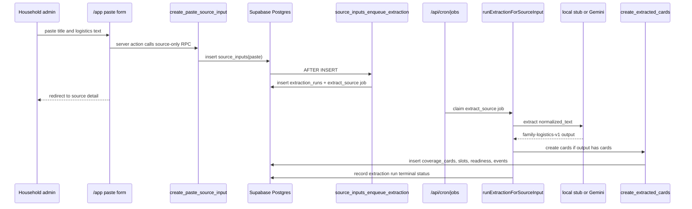

# feat: Add AI-first paste intake

## Overview

Replace the current paste-plus-manual-card flow with a source-only paste submission. A household admin pastes logistics text, FamTandem stores it as a `source_inputs` row, the existing database trigger creates one `extraction_runs` row plus one `extract_source` job, the existing job runner processes the source through the gated extractor, and the source detail page shows run status and linked extracted cards as they become available.

This carries forward the brainstorm decision that FamTandem should start as a live shared coverage board fed by a family logistics inbox, with source-backed coverage cards as the product payoff rather than another manual calendar or task form (see brainstorm: `docs/brainstorms/2026-05-19-famtandem-first-product-shape-brainstorm.md`).

## Problem Statement / Motivation

The current paste intake still asks the parent to manually author the card fields after pasting the source. That undermines the core validation question: whether FamTandem can reduce the default parent's mental load by turning messy inputs into coverage cards.

The desired next slice is narrower and more AI-first:

- Paste text should create only a source input.
- Extraction should use the existing run/job/card creation path.
- The parent should see where the source is in the extraction lifecycle.
- Extracted cards should appear when the run creates them.
- Gemini must stay gated by local environment variables.

Out of scope for this slice: Twilio, Resend, upload OCR/text extraction, Google Calendar, signed downloads, production provider credentials, and broad admin correction.

## Research Summary

### Origin Brainstorm

The May 19 brainstorm established:

- Use family logistics inbox chaos as the input wedge, but make coverage ownership the payoff.
- Accept copied text as one of the first input methods.
- Keep every AI-created card source-backed, with compact source visibility and full source detail behind tap/click.
- Use `Needs Review` for low-confidence or meaningful action-heavy cards.
- Keep the app mobile-first and centered on Needs Attention plus This Week.
- Avoid broad family organizer scope such as chores, meal planning, groceries, chat, and marketplaces.

### Repo Context

- `src/components/board-shell.tsx` currently renders `PasteSourceForm` with both pasted source fields and manual card fields.
- `src/app/app/actions.ts` currently has `createPasteSourceCard`, which calls `create_paste_source_card` and creates a card synchronously.
- `supabase/migrations/20260520010000_phase2_paste_source_intake.sql` defines `create_paste_source_card`, which inserts `source_inputs`, `coverage_cards`, slots, readiness items, audit event, and then marks the source `processed`.
- `supabase/migrations/20260524103000_phase2_extraction_run_persistence.sql` already adds the correct invariant: every new `source_inputs` row gets one `extraction_runs` row and one `jobs.kind = 'extract_source'` job through an `AFTER INSERT` trigger.
- `src/lib/extraction/runner.ts` already runs `start_extraction_run`, loads `source_inputs`, calls the selected extractor, validates `family-logistics-v1`, calls `create_extracted_cards`, and records terminal run state.
- `src/app/api/cron/jobs/route.ts` already routes jobs through `selectExtractor(env)`.
- `src/lib/extraction/provider.ts` keeps Gemini disabled unless `EXTRACTION_PROVIDER='gemini'` and `GEMINI_API_KEY` are both present. Default remains local stub.
- `src/app/app/sources/[sourceInputId]/page.tsx` now shows source details, linked cards, and the read-only `extraction_runs` summary from PR #7 (`293b853`). This slice should reuse that component and focus on contextual empty-card states rather than rebuilding run visibility.
- `tests/e2e/paste-intake.spec.ts` currently asserts the manual paste-card flow and must be rewritten to assert source-only submission plus extraction-run/card behavior.

No `docs/solutions/` institutional learnings exist in this repo.

External research is intentionally skipped. This slice is a local product-flow refactor using established project patterns, not a new provider or framework integration.

## Proposed Solution

### User Flow

1. Household admin opens `/app`.
2. Admin pastes a source title and logistics text only.
3. Submission creates a `source_inputs` row with `source_type = 'paste'`, `normalized_text`, submitter, household, and pending review status.
4. The existing `source_inputs_enqueue_extraction` trigger creates the associated `extraction_runs` row and `extract_source` job.
5. The app redirects to `/app/sources/[sourceInputId]`.
6. Source detail shows extraction status, provider/model, attempts, timestamps, errors/no-action reason, review reasons, and current linked cards through the existing PR #7 run summary.
7. When the existing cron/job runner processes the job:
   - local stub records a no-card succeeded run by default;
   - Gemini, when locally enabled, creates cards through `create_extracted_cards`.
8. The source detail page displays linked cards when ready, and the board displays extracted cards through the existing board query.

### Implementation Shape

- Replace `createPasteSourceCard` with a source-only server action, likely `createPasteSourceInput`.
- Add a small authenticated database RPC for paste source creation, likely `create_paste_source_input(p_pasted_text, p_raw_subject) returns source_input_id`.
- Do not let the browser insert `source_inputs` directly. Keep the same authenticated, household-admin-only, `SECURITY DEFINER` pattern used by current intake RPCs.
- Replace or revoke `create_paste_source_card` so the old reachable `SECURITY DEFINER` path cannot keep creating manual cards from paste. Keeping dead code is acceptable only if execute is revoked from `authenticated` and tests prove the UI no longer calls it.
- On successful paste, redirect to `/app/sources/[sourceInputId]` rather than returning to the board with a manually authored card.
- Reuse the existing source-detail `extraction_runs` query and `ExtractionRunSummary` component.
- Adjust the source detail empty-card state so "No cards are linked yet" is contextual: pending/running means FamTandem is still reading the source, succeeded with zero cards means nothing actionable was found, failed means review is needed.
- Preserve full source access boundaries: parents and household admins can see full source detail; helpers remain denied.

## Technical Considerations

### Database

Add a narrow migration:

```sql
create or replace function public.create_paste_source_input(
  p_pasted_text text,
  p_raw_subject text default 'Pasted logistics'
)
returns table(source_input_id uuid)
language plpgsql
security definer
set search_path = public
as $$
-- Authenticate, require active household_admin, trim/validate text/title,
-- insert source_inputs(source_type='paste', status='pending'),
-- rely on existing AFTER INSERT trigger to enqueue extraction.
$$;
```

Acceptance details:

- Empty or whitespace paste text raises an error.
- Only active `household_admin` members can submit paste sources.
- `source_inputs.status` should remain `pending` at creation. Do not mark the source `processed` at submission time.
- The existing trigger must create one `extraction_runs` row and one `extract_source` job.
- Do not modify the trigger casually; it is the invariant that every source input gets exactly one extraction run.

Update `source_inputs.status` inside the service-role `record_extraction_run` RPC after terminal extraction state so the visible source badge does not remain stale and the run record/status badge stay transactionally aligned:

- `succeeded` with `card_count > 0` -> `processed`
- `succeeded` with `card_count = 0` -> `needs_review`
- `skipped_no_text` -> `needs_review`
- `failed` -> `failed`

Keep `extraction_runs.status` as the detailed lifecycle source of truth, but keep `source_inputs.status` in sync for source-list/detail badges and existing user expectations.

### App Actions

Replace the existing paste action path in `src/app/app/actions.ts`:

- Remove manual card parsing from paste submission.
- Keep only `pastedText` and `rawSubject`.
- Call `create_paste_source_input`.
- Capture `sourceInputSubmitted` with privacy-safe properties only.
- Do not capture `coverageCardCreated` from the paste submit action because cards are now created by extraction, not the form.
- Redirect to `/app/sources/[sourceInputId]`.

### Board UI

In `src/components/board-shell.tsx`:

- Replace the paste form's manual card fields with source-only controls.
- Button copy should set the correct expectation, for example "Read source" or "Create source".
- Keep upload UI unchanged.
- Keep manual card creation available in the separate "Manual card" section for founder/admin fallback, but do not present it as part of paste intake.
- Preserve mobile-first layout and the existing design system constraints from `docs/design/famtandem-v2-design-system.md`.

### Source Detail UI

In `src/app/app/sources/[sourceInputId]/page.tsx`:

- Query the one `extraction_runs` row for the source.
- Render a compact extraction summary:
  - status
  - provider/model
  - attempts/max attempts
  - started/finished timestamps
  - card count
  - review reasons
  - no-action reason
  - last error, if failed
- Keep raw output out of the main UI for now unless a small developer-only `<details>` block is explicitly desired.
- Add a refresh affordance using a normal page reload/link, not a client-side polling system unless tests show the UX needs it.
- Render linked cards once present, reusing existing card summary patterns.

### Extraction Path

Do not add a new extraction endpoint. This slice must use:

- `source_inputs` insert
- existing `AFTER INSERT` trigger
- existing `jobs.kind = 'extract_source'`
- existing protected `/api/cron/jobs`
- existing `selectExtractor(env)` provider gate
- existing `runExtractionForSourceInput`
- existing `create_extracted_cards`

Gemini remains off by default. Production-hosted Gemini credentials remain out of scope.

## System-Wide Impact

### Interaction Graph



### Error Propagation

- Empty paste fails in the RPC and should surface as a form error or server-action error.
- RPC authorization failures should remain 42501-style errors, matching current behavior.
- Job failures should be reflected in `extraction_runs.status = 'failed'` and `last_error`.
- Gemini schema failures should remain contained to the run/job path and should not delete the source input.
- `create_extracted_cards` idempotency protects against duplicate cards on retry.

### State Lifecycle Risks

- Partial source creation is acceptable because source creation is the committed input record. Failed extraction should leave an auditable source and failed run, not roll back the source.
- The existing trigger gives exactly one run per source. Adding a second enqueue from app code would create drift and must be avoided.
- The old paste-card RPC marks sources `processed` synchronously; the new source-only path must not do that and should revoke or replace the old reachable RPC.
- If the cron job has not run, the source detail page must not look broken. It should show `pending` or `running`.
- The local stub returns zero cards by default, so local manual testing without Gemini should clearly explain that no cards were created by the stub.

### API Surface Parity

Surfaces touched:

- `/app` paste intake UI
- `/app` board card rendering after extracted cards exist
- `/app/sources/[sourceInputId]` source detail and extraction status
- `src/app/app/actions.ts` paste server action
- Supabase RPC/migration for source-only paste submission
- E2E paste intake coverage

Surfaces intentionally not touched:

- Upload OCR/text extraction
- Upload metadata and storage policies except for no-regression tests
- Twilio coverage request links
- Resend inbound email
- Google Calendar
- Admin retry/correction UI

## SpecFlow Analysis

### Main Flows

- Happy path with local stub: submit paste, source detail shows pending/running then succeeded/no actionable cards after cron.
- Happy path with Gemini enabled locally: submit paste, process jobs, extracted cards appear on source detail and board.
- Authorization path: helper cannot submit paste source and cannot view full source detail.
- Validation path: empty paste is rejected before a source row is created.
- Failure path: extractor/job fails, source detail shows failed status and last error without losing original source text.
- Retry path: existing job retry reuses the same extraction run and `create_extracted_cards` avoids duplicate cards.

### Gaps Resolved By This Plan

- Manual card fields are removed from paste intake.
- Source detail becomes the trust/status surface.
- The run/job path remains the only extraction path.
- Local stub behavior is made explicit so "no cards" is not mistaken for a broken submission.

### Assumptions

- Household admins remain the only users who can submit paste sources in this slice.
- Parents and household admins can view source details and extraction status; helpers cannot.
- The protected cron route remains the mechanism that runs jobs. The paste submit action does not synchronously call Gemini.
- The source detail page may use manual refresh rather than live polling.

## Acceptance Criteria

### Functional Requirements

- [x] `/app` paste intake collects only source title and pasted text, not card title, time, location, slot, child, source summary, or readiness item fields.
- [x] Paste submit creates exactly one `source_inputs` row with `source_type = 'paste'` and the normalized pasted text.
- [x] Paste submit creates no `coverage_cards` directly.
- [x] The existing `source_inputs` trigger creates exactly one `extraction_runs` row and one `extract_source` job for the pasted source.
- [x] Successful paste submit redirects to `/app/sources/[sourceInputId]`.
- [x] Source detail keeps showing extraction run status, provider/model, attempts, card count, review reasons, timestamps, no-action reason, and last error through the existing `ExtractionRunSummary`.
- [x] Source detail shows linked extracted cards after the existing job path creates them.
- [x] Source detail shows contextual empty-card text for pending/running, succeeded zero-card, skipped, and failed extraction states.
- [x] The board shows extracted cards through the existing `coverage_cards` query once they exist.
- [x] `record_extraction_run` syncs `source_inputs.status` to `processed`, `needs_review`, or `failed` when the run reaches a terminal state.
- [x] Gemini remains disabled unless `EXTRACTION_PROVIDER='gemini'` and `GEMINI_API_KEY` are present in local env.
- [x] Uploads remain metadata/storage only; no upload OCR or text extraction is added.
- [x] No Twilio or Resend paths are added.

### Security And Privacy Requirements

- [x] Only active household admins can submit pasted sources.
- [x] Parents and household admins can read source detail and run status; helpers remain denied.
- [x] Analytics events never include pasted text, names, emails, phone numbers, addresses, source excerpts, raw Gemini output, or last-error text that might contain source data.
- [x] Gemini keys stay local-only and are not committed, documented, or pasted into chat.

### Quality Gates

- [x] Unit tests cover the source-only paste form rendering.
- [x] Unit or migration tests cover the new paste-source RPC authorization, validation, source insert, trigger-created extraction runs/jobs, and revocation/replacement of the old paste-card RPC.
- [x] Source detail renderer tests cover pending/running/succeeded/failed/skipped states.
- [x] Playwright updates cover authenticated paste submission, source detail run status, helper denial, local-stub zero-card completion, and linked extracted-card display when an injected/live extractor creates cards.
- [x] Existing upload E2E still passes.
- [x] Verification commands pass: `npx --yes supabase db reset`, `npm run lint`, `npm run typecheck`, `npm test`, `npm run test:extraction`, `npm run build:local`, `npm run test:e2e:local`.
- [x] Optional local Gemini smoke passes when credentials are available: `EXTRACTION_PROVIDER=gemini npm run test:e2e:local` or the existing live integration test path.

## Suggested Implementation Steps

1. Add source-only paste RPC migration.
2. Replace `createPasteSourceCard` action with `createPasteSourceInput`.
3. Simplify `PasteSourceForm` to source title plus pasted text.
4. Add transactional `source_inputs.status` sync for terminal extraction states.
5. Add contextual source-detail empty-card states around the existing extraction status UI.
6. Update board/source unit tests.
7. Rewrite paste E2E around source-only submission and job processing.
8. Run the full local verification set sequentially.

## Success Metrics

- A pasted source can move through `source_input -> extraction_run -> job -> extracted cards` without manual card field entry.
- In Gemini-enabled local testing, a realistic pasted logistics note produces at least one source-backed coverage card.
- In default local-stub mode, the source lifecycle is still visible and understandable even with zero cards.
- Parents see the source and extraction status clearly enough to trust why cards did or did not appear.

## Dependencies And Risks

- E2E should drive the existing cron/job route explicitly: call `/api/cron/jobs` with the configured `CRON_SECRET`, then poll source detail or database state until the run is terminal. If the browser cannot call the protected route cleanly, use the established service-role helper path in the test; do not add a product-only extraction endpoint.
- The fixture-eval prompt drift noted in `AGENTS.md` is a separate quality issue. This slice should not attempt broad prompt repair unless the current runtime extractor fails the narrow paste E2E.
- Source status must be synced from terminal run state; a stale `pending` badge after a succeeded run is misleading.
- The old `create_paste_source_card` RPC should not remain executable by authenticated users once the UI stops using it.

## Sources And References

- Origin brainstorm: `docs/brainstorms/2026-05-19-famtandem-first-product-shape-brainstorm.md`
- Product context: `CLAUDE.md`
- Architecture notes: `docs/architecture.md`
- Current paste action: `src/app/app/actions.ts`
- Current paste UI: `src/components/board-shell.tsx`
- Source detail page: `src/app/app/sources/[sourceInputId]/page.tsx`
- Paste/card RPC: `supabase/migrations/20260520010000_phase2_paste_source_intake.sql`
- Extraction run trigger/RPCs: `supabase/migrations/20260524103000_phase2_extraction_run_persistence.sql`
- Extraction runner: `src/lib/extraction/runner.ts`
- Provider gate: `src/lib/extraction/provider.ts`
- Cron job route: `src/app/api/cron/jobs/route.ts`
- Existing paste/upload E2E: `tests/e2e/paste-intake.spec.ts`
