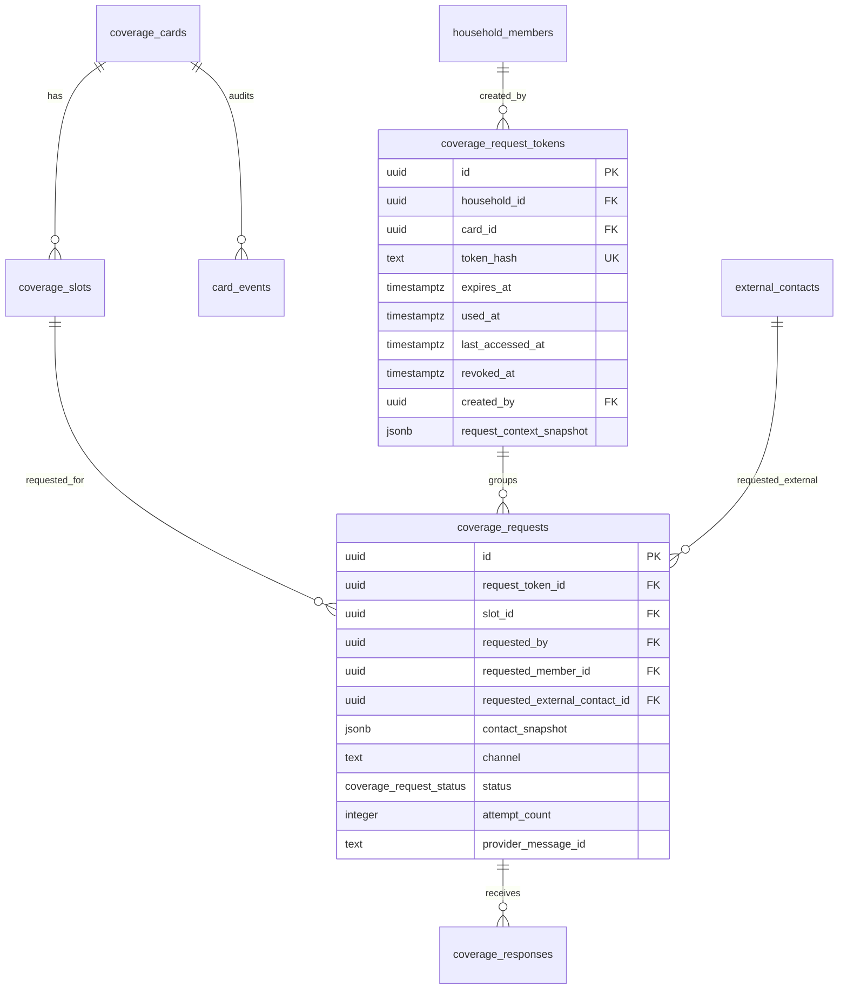
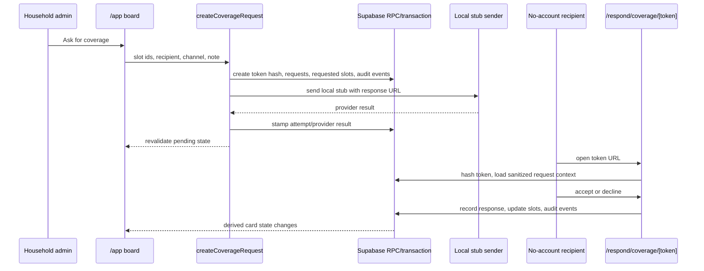

# feat: Add coverage requests and lightweight responses

## Overview

Add the first real "Ask for coverage" loop: a household admin can compose a request from a coverage card, send a lightweight no-account link to a household member or external helper, and let that recipient accept or decline coverage from a narrow public page. Build the flow with local stub senders first. Twilio and Resend credentials stay out of scope until the token flow, response transitions, audit trail, and analytics are tested end to end.

This carries forward the brainstorm decision that FamTandem's payoff is shared coverage, not another shared calendar: default parents need to know who owns drop-off, pickup, attendance, prep, or another coverage slot, who was asked, what changed, and what is still uncovered (see brainstorm: `docs/brainstorms/2026-05-19-famtandem-first-product-shape-brainstorm.md`). It also carries forward the positioning decision to serve the overloaded default parent with a practical "never be the only one who knows what needs to happen" workflow (see brainstorm: `docs/brainstorms/2026-05-18-familyops-positioning-brainstorm.md`).

## Problem Statement

Phase 1 supports manual slot state changes: "I'll cover it," "Mark already covered," and admin state edits. It does not yet let the default parent ask another person for coverage and receive a lightweight response without requiring that person to create an account.

That blocks the core validation moment:

> FamTandem identifies an uncovered item and a coverage request gets accepted.

This slice should validate whether a coverage request can move a real household slot from "needs coverage" to confirmed ownership with minimal friction, while preserving source privacy and auditability.

## Research Summary

### Origin Brainstorms

The May 19 first-product-shape brainstorm established these requirements:

- The primary action is "Ask for coverage."
- Other parents, caregivers, grandparents, carpools, and one-off helpers should be able to respond through lightweight SMS/email links without full account creation.
- Single-purpose request links should show only what the recipient needs: what, when, where, child, requested responsibility, enough context to say yes or no, and accept/decline controls.
- Direct requests remain pending until accepted.
- Declines should make the slot need coverage again and make "Ask someone else" the natural next action.
- Split responses matter for transportation workflows: "I can do drop-off," "I can do pickup," "I can do both," or "I can't cover this."

The May 18 positioning brainstorm reinforces why this matters: FamTandem should own coverage as the differentiator and should reduce the invisible default-parent coordination burden, not just make schedule visibility nicer.

### Repo Context

- `coverage_slots` already model slot kind, state, owner member, external contact, and free-form external owner text in `supabase/migrations/20260519010000_phase1_manual_board.sql`.
- `coverage_requests` and `coverage_responses` already exist, but they are not yet used by the app. `coverage_requests` currently has one `slot_id`, optional requested member/contact, `contact_snapshot`, `channel`, nullable `token_hash`, `expires_at`, status, attempt count, last token access, and provider message id.
- `coverage_response_value` already includes `accept_dropoff`, `accept_pickup`, `accept_both`, `decline`, and `comment`, which matches the brainstorm's split-response model.
- `src/app/app/actions.ts` has `transitionSlot`, `markSlotAlreadyCovered`, `coverSlotAsCurrentMember`, `setSlotState`, and `logCardEvent`; request transitions should reuse the same state rules and `refreshCardState` behavior instead of inventing parallel card-state derivation.
- `src/lib/coverage-state.ts` already treats `requested` as pending and `declined` as needing coverage.
- `src/components/board-shell.tsx` already has an "Ask for coverage" quick-action label, but slot cards only expose "I'll cover it," "Mark already covered," and admin state controls.
- `src/lib/posthog/events.ts` and `src/lib/posthog/server.ts` provide privacy-safe server analytics helpers.
- The existing jobs runner pattern in `src/lib/jobs/runner.ts` can support a future `send_coverage_request` job, but this slice can also send through a local stub synchronously if the implementation keeps idempotency and retry behavior simple.
- No relevant `docs/solutions/` learning exists for coverage requests; the only current solution doc is Gemini fixture-eval prompt drift.

### External Provider Notes

Provider implementation is deferred, but adapter seams should match current provider behavior:

- Twilio's Message resource requires recipient, sender, and content to create outbound messages; Messaging Services use `MessagingServiceSid`, and Twilio status callbacks POST evolving status fields such as `MessageStatus` and `ErrorCode`. The future Twilio adapter should store provider ids and accept evolving callback payloads without assuming a fixed field set. Source: <https://www.twilio.com/docs/messaging/api/message-resource>
- Resend's `POST /emails` returns an email id and supports an `Idempotency-Key` header for duplicate-safe retries. Keys are unique per API request, expire after 24 hours, and may be formatted around an entity id such as an event/request id. Source: <https://resend.com/docs/api-reference/emails/send-email> and <https://resend.com/docs/dashboard/emails/idempotency-keys>

External credentials, hosted provider configuration, inbound provider callbacks, and delivery-status UI are out of scope for this plan.

## Proposed Solution

### User Flow

1. Household admin opens a coverage card with one or more slots that need coverage.
2. Admin opens "Ask for coverage" from a slot or card-level request composer.
3. Admin chooses:
   - requested slot(s): one slot by default; drop-off + pickup together when both are present and uncovered;
   - recipient: active household member/helper or external contact;
   - channel: local stub SMS, local stub email, or manual copy link depending on contact details;
   - optional short note.
4. Server creates a request token, stores only its hash, creates one `coverage_requests` row per requested slot, moves those slots to `requested`, logs audit events, and sends through the selected local stub adapter.
5. Board shows the card as `Pending` and the slot owner label as "Waiting on [recipient]."
6. Recipient opens the no-account response link.
7. Public page validates the token and shows only the minimum request context.
8. Recipient chooses an accept action or decline.
9. Server records `coverage_responses`, updates request and slot state transactionally, logs audit events, captures PostHog events, and shows a confirmation page.
10. Board reflects `accepted`, `declined`, or still `requested` state through the existing card-state derivation.

### Scope Boundaries

In scope:

- Request composer UI on board cards.
- Hashed token persistence and lookup behavior.
- No-account accept/decline page.
- Slot state transitions for requested, accepted, declined, expired, and cancelled cases.
- `coverage_requests`, `coverage_responses`, and `card_events` audit trail.
- Privacy-safe PostHog server events.
- Provider adapter interfaces and local stub SMS/email/manual-link senders.
- Tests that prove token flow before any Twilio/Resend credentials are added.

Out of scope:

- Real Twilio or Resend credentials.
- Provider webhook endpoints and delivery-status UI.
- Inbound SMS/email response parsing.
- Automatic reminders/escalations.
- Google Calendar.
- OCR or upload extraction.
- Broad admin correction surfaces.
- Children as notification targets.

## Technical Approach

### Data Model

Use a dedicated token table instead of relying on plaintext or nullable `coverage_requests.token_hash` per row. The existing `coverage_requests` table remains the per-slot request record.



Migration notes:

- Add `coverage_request_tokens`.
- Add nullable `request_token_id` to `coverage_requests` with an index.
- Keep existing `coverage_requests.token_hash`, `expires_at`, and `last_token_access_at` initially for backward compatibility, but new code should write token state to `coverage_request_tokens`.
- Add a unique index on `coverage_request_tokens.token_hash`.
- Add `coverage_request_tokens_household_id_idx`, `coverage_request_tokens_card_id_idx`, and `coverage_requests_request_token_id_idx`.
- Enable RLS on `coverage_request_tokens`.
- Do not grant direct member SELECT on `coverage_request_tokens`; RLS should deny ordinary authenticated and anon reads. If admin UI later needs token metadata, expose a sanitized view/RPC that omits `token_hash`.
- Do not grant anon direct table access. The public no-account page should call server code that uses service-role RPCs after hashing the presented token.
- Never write the legacy `coverage_requests.token_hash`; that column is on a member-readable table and remains for backwards-compatible schema shape only.

Token behavior:

- Generate at least 32 bytes of cryptographically random token material in server TypeScript and encode URL-safe.
- Store HMAC-SHA-256 using a server-only secret in `coverage_request_tokens.token_hash`.
- The database must never generate or receive the plaintext token. Server TypeScript passes only the hash into the create RPC, and the public response route hashes the presented token before calling service-role RPCs.
- Never store or log the plaintext token.
- Default expiry: 7 days for validation cohort; make it an env/config constant in code, not a user-facing setting.
- Token lookup should be constant in behavior from the user's perspective: invalid, expired, revoked, and already-final requests all render safe generic states without revealing household internals.
- `last_accessed_at` may update on valid token views; avoid recording IP/user-agent unless there is a clear abuse need.
- In local development, derive the HMAC key from `CRON_SECRET` if a dedicated `COVERAGE_REQUEST_TOKEN_SECRET` is not set. Before production, add a dedicated server-only secret.

### RPCs And Server Boundaries

Add service-role-only `SECURITY DEFINER` RPCs with narrow responsibilities:

```sql
create_coverage_request(...)
respond_to_coverage_request(...)
expire_coverage_request_token(...)
cancel_coverage_request_token(...)
```

Recommended responsibilities:

- `create_coverage_request`:
  - Requires authenticated active `household_admin`.
  - Validates all slot ids belong to one card in the admin's household.
  - Accepts one or two slot ids; use two only for drop-off + pickup on the same card.
  - Validates requested household member/helper or external contact belongs to the same household.
  - Creates an external contact if the composer uses free-form external recipient details.
  - Accepts a server-generated token hash and creates the token row with that hash.
  - Creates one `coverage_requests` row per slot.
  - Moves eligible slots from `needs_coverage` or `declined` to `requested`.
  - Inserts `card_events` for request creation.
  - Returns request ids and token row id. Plaintext token stays only in server TypeScript for immediate link composition.

- `respond_to_coverage_request`:
  - Runs only through service-role server code from the public response action.
  - Accepts the server-computed token hash and loads the token row plus child request rows.
  - Rejects expired/revoked/final tokens safely.
  - Supports `accept_dropoff`, `accept_pickup`, `accept_both`, and `decline`.
  - Updates only the requested slots covered by the selected response.
  - For household-member recipients, sets `coverage_slots.state = 'accepted'` and `owner_member_id = requested_member_id`.
  - For external-contact recipients, sets `coverage_slots.state = 'accepted'` and `external_contact_id = requested_external_contact_id`.
  - For decline, sets selected request rows to `declined`, clears owner fields, and sets slots to `declined` so `deriveAttentionFlags` keeps them in Needs Attention.
  - Inserts `coverage_responses` rows with no sensitive free-form payload unless explicitly collected.
  - Inserts `card_events` for accept/decline and calls/duplicates the same card-state refresh behavior used by authenticated slot transitions.
  - Uses a narrow trigger-safe mutation path. Existing `coverage_slots_validate_household_refs` rejects unauthenticated/non-admin updates, so this migration must either update that trigger to allow the current service-role RPC by checking `current_setting('request.jwt.claim.role', true) = 'service_role'`, or perform the slot update inside a dedicated SECURITY DEFINER helper that the trigger recognizes through a transaction-local setting. The chosen implementation must be service-role-only and covered by tests.

Request/response business logic may use TypeScript service modules for token generation, HMAC hashing, URL composition, send adapter selection, and analytics. Multi-row state changes must happen in database RPC transactions so response submission cannot partially accept a slot without recording the response.

### App Routes And Actions

Authenticated board:

- Add `src/lib/coverage-requests/create.ts` for request creation orchestration.
- Add a server action in `src/app/app/actions.ts`, likely `createCoverageRequest`.
- Add request composer UI in `src/components/board-shell.tsx`.
- Composer should be compact, inside each slot/card's existing "Manage coverage" area for household admins.
- Include recipient choice, channel choice, optional note, and selected slots when the card has drop-off/pickup together.
- After create, revalidate `/app` and show the pending state. If local stub/manual link is used, show or copy the response URL only in dev/test-safe UI.

Public response:

- Add a public route such as `src/app/respond/coverage/[token]/page.tsx`.
- Keep the page outside `/app` and do not require Supabase Auth.
- The GET page should load a sanitized response view through a server-only helper:
  - card title;
  - child display name if attached;
  - starts_at and location;
  - requested slot labels;
  - requester display name;
  - optional note;
  - compact source summary only, not full source text.
- Add server action `respondToCoverageRequest` colocated with the public route.
- The POST action should redirect to a confirmation state and avoid exposing stack traces for invalid/expired tokens.
- Do not render household member lists, full board navigation, source text, raw artifacts, extraction runs, or other cards.

### Provider Adapter Interfaces

Create a provider seam now, with local stubs only:

```ts
export type CoverageRequestChannel = "sms" | "email" | "manual_link";

export type CoverageRequestSendInput = {
  requestTokenId: string;
  requestIds: string[];
  channel: CoverageRequestChannel;
  to: string | null;
  recipientLabel: string;
  message: string;
  responseUrl: string;
  idempotencyKey: string;
};

export type CoverageRequestSendResult = {
  provider: "local-stub" | "twilio" | "resend";
  providerMessageId: string | null;
  status: "stubbed" | "queued" | "sent" | "failed";
  raw?: Record<string, unknown>;
};

export interface CoverageRequestSender {
  send(input: CoverageRequestSendInput): Promise<CoverageRequestSendResult>;
}
```

Files:

- `src/lib/coverage-requests/senders/types.ts`
- `src/lib/coverage-requests/senders/local-stub.ts`
- `src/lib/coverage-requests/senders/provider.ts`

Provider selection:

- Default to local stub.
- Do not add Twilio/Resend packages or env vars in this slice unless needed for type-only interfaces.
- Keep the interface compatible with future Twilio Message resource ids and Resend email ids.
- Use `requestTokenId` or `coverage-request/<token-id>/<channel>` as the future idempotency key. This aligns with Resend's idempotency-key model and is also useful for local retry tests.

Sending model:

- Prefer adding a `send_coverage_request` job kind if implementation time allows, because provider sends are side effects and the existing job runner already owns retry semantics.
- If this slice sends synchronously through the local stub, keep the code shaped so it can move into the job runner without changing database contracts.
- In either model, increment `coverage_requests.attempt_count` and store `provider_message_id` from the stub result.

### Slot State Transitions

Allowed transitions for this slice:

- `needs_coverage` -> `requested` when a request is created.
- `declined` -> `requested` when asking someone else.
- `requested` -> `accepted` when the recipient accepts.
- `requested` -> `declined` when the recipient declines.
- `requested` -> `needs_coverage` or `cancelled` when admin cancels before response. Prefer `cancelled` for audit clarity, but ensure the board still lets the admin ask again.
- Expired pending requests should mark requests `expired` and move requested slots back to `needs_coverage` or `declined` based on product copy. Prefer `needs_coverage` for expired because no one actively declined.

Split response rule:

- One token response consumes the whole token.
- `accept_both` accepts every pending slot in the token.
- `accept_dropoff` accepts the drop-off slot and marks other pending sibling requests in the token `declined`, moving those unselected slots to `declined`.
- `accept_pickup` accepts the pickup slot and marks other pending sibling requests in the token `declined`, moving those unselected slots to `declined`.
- `decline` declines every pending request in the token.
- This keeps the no-account UX single-purpose and avoids a stale token changing pickup later after the recipient has already answered.

Idempotency:

- Re-submitting an accepted token should not create duplicate responses or re-transition slots.
- Re-submitting a declined token should not duplicate decline events.
- Implement response idempotency with row locks in the response RPC (`for update` on the token row and child request rows) plus a uniqueness guard on `coverage_responses(request_id)` for final responses.
- Add an active-request uniqueness guard so one slot cannot have multiple pending `coverage_requests` at the same time.
- If a slot was already covered by someone else before token response, the response page should show "This is already covered" and should not override ownership.

### Audit Events

Use `card_events` for a readable household audit trail:

- `coverage_request_created`
- `coverage_request_send_stubbed`
- `coverage_request_link_opened`
- `coverage_request_accepted`
- `coverage_request_declined`
- `coverage_request_cancelled`
- `coverage_request_expired`

Metadata should include internal ids and coarse fields only:

- `request_token_id`
- `request_ids`
- `slot_ids`
- `slot_kinds`
- `channel`
- `recipient_type` (`household_member`, `external_contact`)
- `response_value`
- `provider`

Do not put phone numbers, email addresses, source excerpts, raw notes, token plaintext, or child names into `card_events.metadata`.

### PostHog Events

Add privacy-safe events in `src/lib/posthog/events.ts`:

- `coverageRequestCreated`
- `coverageRequestSendAttempted`
- `coverageRequestLinkOpened`
- `coverageRequestAccepted`
- `coverageRequestDeclined`
- `coverageRequestExpired`

Recommended properties:

- `household_id`
- `card_id`
- `request_token_id`
- `request_count`
- `slot_kind`
- `slot_count`
- `channel`
- `recipient_type`
- `provider`
- `response_value`
- `latency_bucket` for response time from created to responded

Never send token plaintext, phone/email, contact names, child names, source text, addresses, or optional note text.

## System-Wide Impact

### Interaction Graph



### Error And Failure Propagation

- Request creation authorization errors should behave like existing household-admin-only actions.
- Token creation and slot transition must be transactional. If token insert succeeds but slot update fails, the request should not exist.
- Stub sender failure should not lose the request row; mark send attempt failed and leave slot `requested` only if a manual link is still available. Otherwise roll back request creation or return a clear retry state.
- Public token errors must render controlled UI states, not stack traces.
- PostHog failures should be swallowed like existing server analytics.

### State Lifecycle Risks

- The main duplication risk is retrying request creation and sending multiple messages. Mitigate with token-level idempotency and sender idempotency keys.
- The main privacy risk is exposing full source context on the public response page. Mitigate by building a sanitized query shape that never loads `source_inputs.normalized_text` or `source_artifacts`.
- The main consistency risk is updating a slot without recording a response. Mitigate with a transaction/RPC for public responses.
- The main social risk is an old token overriding a newer offline decision. Mitigate by checking current slot state before accepting and refusing to overwrite already-covered slots.

### API Surface Parity

Update all paths that can affect coverage:

- Authenticated "I'll cover it" remains immediate self-accept.
- Authenticated "Mark already covered" remains admin-confirmed offline coverage.
- New "Ask for coverage" creates pending request state.
- Public accept/decline uses the same state rules and card refresh derivation.
- Admin state override should either cancel pending requests or leave a clear audit event if it supersedes them.

## SpecFlow Analysis

### Happy Path

- Admin requests pickup coverage from a spouse by local stub SMS.
- Slot moves `needs_coverage` -> `requested`.
- Recipient opens link and accepts pickup.
- Request becomes `accepted`, response row is inserted, slot becomes `accepted` with the spouse as owner, card state becomes covered or reflects remaining unresolved items.

### Edge Cases To Include

- Expired token opened.
- Invalid token opened.
- Token opened after request was cancelled.
- Token opened after slot was manually covered by someone else.
- Recipient declines.
- Recipient accepts only drop-off when token includes drop-off and pickup.
- Recipient accepts both drop-off and pickup.
- Household admin asks an external contact with email but no account.
- Helper/non-admin attempts to create a request and is denied.
- Public response page attempts to infer data for another household and cannot.

### Acceptance Criteria Adjustments From SpecFlow

- Public response page must load only by token, never by `card_id` or `request_id` URL parameters.
- Response submission must be idempotent.
- Tests must assert plaintext tokens are absent from database rows, audit metadata, and analytics properties.
- Tests must assert helper denial for request creation and no-account success for response.
- Split response must not accidentally finalize unselected slots.

## Implementation Checklist

### Database

- [x] Add `coverage_request_tokens` table with hashed token, expiry, revocation/use/access timestamps, household/card links, creator, and context snapshot.
- [x] Add `coverage_requests.request_token_id` and indexes.
- [x] Add RLS policies that deny direct token-table reads/writes to ordinary authenticated and anon users.
- [x] Add service-role/authenticated RPC function for household-admin request creation that accepts only a server-generated token hash.
- [x] Add service-role-only RPC function for public token response by token hash.
- [x] Add trigger-safe service-role slot mutation path for no-account responses.
- [x] Add response and active-request uniqueness/locking for DB-level idempotency.
- [x] Add cancellation/expiry helper if not handled directly in TypeScript.
- [x] Add same-household validation for token/card/request/slot/contact relationships.

### App And UI

- [x] Add request composer to coverage cards in `src/components/board-shell.tsx`.
- [x] Add `createCoverageRequest` server action in `src/app/app/actions.ts` or a dedicated action module.
- [x] Add public response route under `src/app/respond/coverage/[token]/`.
- [x] Add sanitized request-view mapper that excludes full source text and artifacts.
- [x] Update board labels so pending/declined request states read naturally.
- [x] Add confirmation and invalid/expired token states.

### Provider Stubs

- [x] Add coverage-request sender interface.
- [x] Add local stub SMS sender.
- [x] Add local stub email sender.
- [x] Add manual-link sender/result path.
- [x] Add provider selector that defaults to local stubs and does not require Twilio/Resend env vars.
- [x] Store stub provider results on request rows.

### Audit And Analytics

- [x] Add request/response `card_events`.
- [x] Add PostHog event names.
- [x] Capture request created/send attempted/link opened/accepted/declined/expired events with privacy-safe properties.
- [x] Add tests proving sensitive fields are not sent to PostHog.

### Tests

- [x] Migration/security tests for token table, RLS denial, same-household validation, and helper denial.
- [x] Unit tests for token hashing and lookup behavior.
- [x] Unit tests for provider selector and local stub senders.
- [x] Unit tests for request/response state transitions and idempotency.
- [x] Server/action tests for request creation and PostHog properties.
- [x] Playwright local e2e for admin request -> no-account accept.
- [x] Playwright local e2e for admin request -> no-account decline.
- [x] Playwright local e2e for invalid/expired token page.

## Acceptance Criteria

### Functional

- [x] Household admins can ask for coverage from an eligible slot on a coverage card.
- [x] Request creation stores only a hashed token and returns plaintext token only for immediate link composition.
- [x] Request creation moves selected slots to `requested`.
- [x] No-account public page shows limited request context and accept/decline controls.
- [x] Accepting coverage updates request, response, slot owner, card audit, and derived card state.
- [x] Declining coverage updates request, response, slot state, card audit, and keeps the card in Needs Attention.
- [x] Split drop-off/pickup responses work without changing unselected slots.
- [x] Expired, cancelled, invalid, and already-final tokens show safe non-leaky UI states.
- [x] Local stub SMS/email/manual-link senders are the only active senders.
- [x] Twilio/Resend credentials are not required and no real outbound message is sent.

### Non-Functional

- [x] Public response flow does not require account creation.
- [x] Public response route does not expose full source text, artifacts, household board data, extraction runs, or unrelated cards.
- [x] Token response is idempotent.
- [x] Analytics and audit metadata exclude phone numbers, emails, child names, source text, notes, and plaintext tokens.
- [x] The UI remains mobile-first and consistent with `docs/design/famtandem-v2-design-system.md`.

### Quality Gates

- [x] `npx --yes supabase db reset --local`
- [x] `npm run lint`
- [x] `npm run typecheck`
- [x] `npm test`
- [x] `npm run test:extraction`
- [x] `npm run build:local`
- [x] `npm run test:e2e:local`
- [x] `ce-review` before merge.
- [x] Read-only Cursor `gpt-5.5-high` review before merge because this touches token security, RLS, background/provider seams, source privacy, and public no-account access.
  - Cursor found one blocking privacy issue: client-side PostHog autocapture could include plaintext response tokens in `$current_url` on `/respond/coverage/[token]`. Fixed by disabling PostHog autocapture globally and relying on explicit privacy-safe events.
  - Follow-up CE/Cursor review found no blockers. Medium findings were fixed before handoff: the public token route is now a browser-analytics dead zone, the composer copy makes recipient-visible notes explicit, visible local UI only creates a manual response link, stale submissions do not emit accepted/declined analytics, send marking is constrained to `local-stub`, and `coverage_requests.request_token_id` is validated against the same card/household as the slot.

## Success Metrics

Product validation metrics:

- Coverage requests created per household per week.
- Coverage request acceptance rate.
- Coverage request decline rate.
- Median time from request created to response.
- Number of uncovered slots resolved through lightweight links.
- Number of times default parent still needs to manually mark coverage after a request.

Truth metric:

> Did this reduce the number of times you had to ask, remind, clarify, or hold the plan in your head this week?

## Dependencies And Risks

Dependencies:

- Existing Supabase Auth/household membership.
- Existing coverage slot state model.
- Existing PostHog server capture helper.
- Existing Playwright local auth setup.
- A server-only token pepper/secret. If no suitable env exists, add one to local setup docs and `getServerEnv`.

Risks:

- Token leakage through logs or analytics. Mitigation: no plaintext token in DB, events, audit metadata, or logs.
- Public page overexposes household/source context. Mitigation: sanitized response-view query and tests.
- Stale token overwrites newer manual coverage. Mitigation: current-slot-state check before transition.
- Request grouping adds complexity. Mitigation: support one slot by default and at most drop-off + pickup on one card in this slice.
- Future provider callbacks may need schema changes. Mitigation: keep provider result fields generic and store raw callback handling for a later provider slice.

## Future Considerations

- Real Twilio adapter with Messaging Service support and status callback verification.
- Real Resend adapter with idempotency keys.
- Provider webhook routes and delivery status events.
- Reminder/escalation rules after validation shows families want them.
- Inbound SMS/email responses.
- One-off contact identity verification or magic-link claiming for repeat helpers.
- Request history timeline on card detail.

## Sources And References

### Origin

- **Brainstorm document:** `docs/brainstorms/2026-05-19-famtandem-first-product-shape-brainstorm.md` — carried forward the live coverage board, Ask for coverage primary action, lightweight no-account response links, split drop-off/pickup response model, and source/privacy boundaries.
- **Positioning brainstorm:** `docs/brainstorms/2026-05-18-familyops-positioning-brainstorm.md` — carried forward the overloaded default parent, shared coverage differentiator, and "never be the only one who knows what needs to happen" promise.

### Internal References

- `supabase/migrations/20260519010000_phase1_manual_board.sql` — coverage slot, request, response, external contact, and audit tables.
- `src/app/app/actions.ts` — current slot transition, card refresh, and audit patterns.
- `src/lib/coverage-state.ts` — derived attention and coverage state rules.
- `src/components/board-shell.tsx` — board card controls and mobile-first UI pattern.
- `src/lib/posthog/events.ts` and `src/lib/posthog/server.ts` — analytics event naming and server capture.
- `src/lib/jobs/runner.ts` — optional background send job pattern.
- `docs/design/famtandem-v2-design-system.md` — UI continuity guide.

### External References

- Twilio Messages resource: <https://www.twilio.com/docs/messaging/api/message-resource>
- Resend send email API: <https://resend.com/docs/api-reference/emails/send-email>
- Resend idempotency keys: <https://resend.com/docs/dashboard/emails/idempotency-keys>
